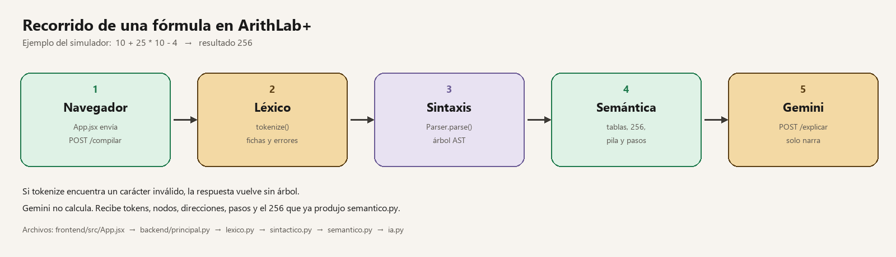
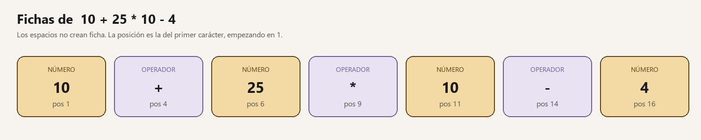
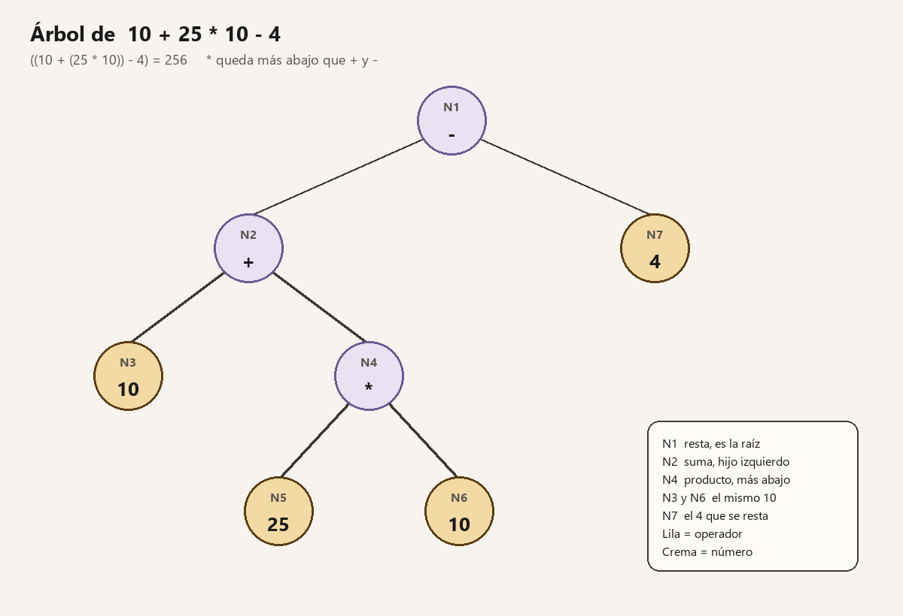
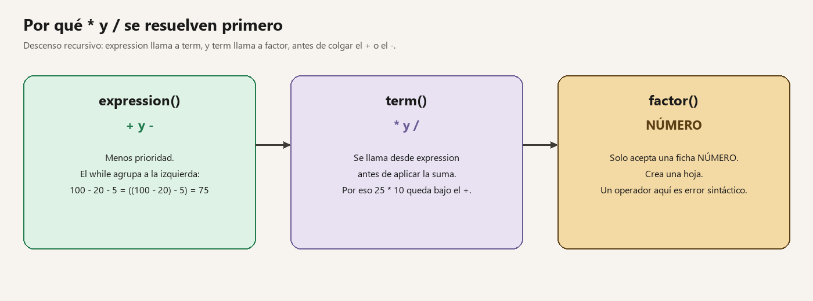
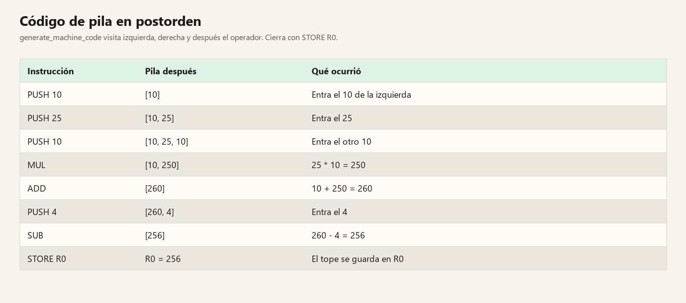

# ArithLab+

Simulador interactivo de un compilador aritmético para el proyecto final de Teoría de Compiladores. La lógica está en Python (FastAPI) y la interfaz en React + Vite. El lenguaje solo acepta números enteros y los operadores `+`, `-`, `*` y `/`.

La defensa del código, con el recorrido de `10 + 25 * 10 - 4`, las figuras, los imports y las preguntas de la profesora, está en [Análisis técnico adicional para la defensa](#defensa). Cada `while`, cada `for`, cada `if` y cada `import`, línea por línea, está en [Cada ciclo, condicional e import](#ciclos). Lo que sigue debajo de este párrafo se conserva igual.

## Estructura

```text
package.json          # arranca frontend y backend juntos
models/               # ejemplos JSON del AST y de la respuesta
backend/
  __init__.py         # deja la carpeta como paquete de Python
  requirements.txt    # FastAPI, Uvicorn y python-dotenv
  .env.example        # plantilla de la clave de Gemini (sin la clave real)
  lexico.py           # fichas y errores de carácter
  sintactico.py       # descenso recursivo y árbol
  semantico.py        # tablas, resultado, pasos y código de pila
  ia.py               # Gemini redacta las explicaciones
  principal.py        # rutas /compilar, /explicar y /explicar-error
  pruebas.py          # pruebas del compilador, sin llamar a la red
frontend/
  .env.example        # dirección del backend cuando no es localhost
  src/main.jsx        # monta la aplicación en la página
  src/App.jsx         # simulador: fórmula, árbol, tablas y Gemini
  src/styles.css      # colores, paneles y animación del árbol
```

`backend/.env` guarda la clave real y no se publica. `node_modules/` y `__pycache__/` se generan solos.

## Cómo se recorre una fórmula

Ejemplo usado en el simulador: `10 + 25 * 10 - 4`. El resultado es **256**.

1. El navegador envía `POST /compilar` con la fórmula, si las posiciones empiezan en 0 y la hora del usuario.
2. `lexico.tokenize` parte el texto en fichas. Los espacios se saltan. Los dígitos seguidos forman un solo número. Un carácter distinto de dígito, espacio y `+ - * /` se anota como error y el recorrido sigue, para listar todos los errores.
3. Si hay error léxico, la respuesta vuelve con las fichas reconocidas y sin árbol. El navegador pide entonces `POST /explicar-error`.
4. Si el texto es válido, `sintactico.Parser` arma el árbol. `term()` se resuelve antes que `expression()`, así que `*` y `/` quedan más abajo que `+` y `-`. Las operaciones del mismo nivel se agrupan de izquierda a derecha.
5. `semantico.build_tables` da una dirección `dir_1`, `dir_2`... a cada número distinto, y el tipo `entero`. Un número repetido no crea otra fila: en el ejemplo el `10` aparece dos veces y solo hay una fila.
6. `evaluate` calcula el valor recorriendo primero los hijos. `build_resolution_steps` escribe cada reducción. `generate_machine_code` emite instrucciones de pila en postorden y cierra con `STORE R0`.
7. `/compilar` devuelve esos datos con las explicaciones vacías. Enseguida el navegador llama `POST /explicar`.
8. `ia.py` no calcula la fórmula. Le entrega a Gemini los números ya calculados y el saludo según la hora (`Buenos días`, `Buenas tardes` o `Buenas noches`). La interfaz solo muestra el texto si el modelo empieza por `gemini`.

Árbol de `10 + 25 * 10 - 4`, en el mismo orden de las bolitas N1…N7:

```text
N1  -          raíz
N2  +          hijo izquierdo de N1
N3  10         hijo izquierdo de N2
N4  *          hijo derecho de N2
N5  25         hijo izquierdo de N4
N6  10         hijo derecho de N4
N7  4          hijo derecho de N1
```

Código de pila de esa fórmula:

```text
PUSH 10
PUSH 25
PUSH 10
MUL          25 * 10 = 250
ADD          10 + 250 = 260
PUSH 4
SUB          260 - 4 = 256
STORE R0
```

Tabla de símbolos y de tipos:

| Símbolo | Dirección | Tipo |
|---|---|---|
| 10 | dir_1 | entero |
| 25 | dir_2 | entero |
| 4 | dir_3 | entero |

Si la fórmula es `7 $ 3 & 2`, el léxico reconoce `7`, `3` y `2`, y reporta `$` en la posición 3 y `&` en la posición 7. No hay árbol, ni direcciones, ni código de pila. Cada panel vacío recibe su propia explicación de por qué esa fase no corrió.

## Rutas

Todas reciben el mismo cuerpo. El navegador manda `source`, `zero_based` y `hora_cliente`. En Python esos campos se llaman `fuente`, `base_cero` y `hora_cliente`.

| Método y ruta | Qué hace |
|---|---|
| `GET /health` | Responde `{"ok": true, "service": "arithlab-backend"}`. |
| `POST /compilar` | Léxico, árbol, tablas, resultado y código. No redacta textos. |
| `POST /explicar` | Vuelve a compilar y pide a Gemini la explicación de una fórmula válida. |
| `POST /explicar-error` | Pide a Gemini por qué falló cada fase. |

Claves que lee la interfaz: `tokens` (`type`, `value`, `position`), `ast` (`value`, `left`, `right`), `ast_text`, `simbolos` (`symbol`, `address`), `tipos` (`symbol`, `type`), `errores`, `resultado`, `codigo_maquina`, `pasos_resolucion` (`calculation`, `expression`, `priority`), `explicacion_ia`, `explicacion_ast`, `explicacion_semantica`, `explicacion_tipos`, `explicacion_codigo_maquina`, `explicacion_error`, `explicacion_tokens`, `explicacion_resultado`, `modelo_ia`, `ia_error`, `base_posiciones`.

## Ejecución

Desde la carpeta raíz:

```powershell
npm install
npm run install:all
npm run dev
```

El frontend queda en `http://localhost:5173` y FastAPI en `http://localhost:8000`. También se puede hacer doble clic en `INICIAR_ARITHLAB.bat`.

Solo el backend:

```powershell
python -m venv .venv
.venv\Scripts\activate
pip install -r backend/requirements.txt
python -m uvicorn backend.principal:app --reload --port 8000
```

Pruebas, desde la raíz. Quitan la clave de Gemini para no salir a internet:

```powershell
python -m unittest backend.pruebas
```

## Gemini

La clave vive solo en el backend. El navegador nunca la ve.

1. Crear la clave en `https://aistudio.google.com/apikey`.
2. Copiar `backend/.env.example` como `backend/.env` y pegar la clave en `GEMINI_API_KEY`.
3. El modelo del proyecto es `gemini-3.5-flash-lite`. Si ese nombre falla, se prueban `gemini-3.5-flash` y `gemini-flash-lite-latest`.
4. Sin clave, el compilador sigue calculando. Las pruebas leen el texto local de respaldo. La interfaz no presenta ese texto como respuesta de Gemini.

En Render, `render.yaml` instala `backend/requirements.txt`, arranca `uvicorn backend.principal:app` y espera `GEMINI_API_KEY` como variable secreta.

## Archivo por archivo

El orden de lectura es el orden de la compilación: dependencias, léxico, sintaxis, semántica, inteligencia artificial, rutas y pruebas.

### `backend/requirements.txt`

Instala el servidor, el recargado automático y la lectura de `backend/.env`.

```text
fastapi==0.115.6
uvicorn[standard]==0.34.0
python-dotenv==1.0.1
```

### `backend/.env.example`

Plantilla pública. La clave real no va en este archivo ni en el README.

```text
GEMINI_API_KEY=
GEMINI_MODEL=gemini-3.5-flash-lite
```

### `backend/__init__.py`

Archivo vacío. Hace que `backend` sea un paquete, y por eso funcionan `from .lexico import tokenize` y el comando `backend.principal:app`. Si se borra, esas importaciones dejan de resolverse.

### `backend/lexico.py`

Primera fase. `tokenize` recorre la fórmula de izquierda a derecha.

- Un espacio avanza `indice` y no crea ficha.
- Varios dígitos seguidos forman un entero. La posición guardada es la del primer dígito, empezando en 1.
- `+ - * /` son fichas `OPERADOR`.
- Cualquier otro carácter se agrega a `errores` y el ciclo continúa.
- `token_as_dict` traduce `tipo`, `valor` y `posicion` a `type`, `value` y `position`, que es lo que lee la interfaz.

Si se quita el `indice += 1` del final, un carácter inválido dejaría el ciclo sin terminar.

````python
"""Analizador léxico del lenguaje aritmético.

principal.compile_expression llama a tokenize con el texto de la fórmula.
Si se elimina este módulo, no existen fichas ni errores de carácter inválido.
"""

from dataclasses import dataclass

_OPERADORES = "+-*/"


@dataclass(frozen=True)
class Token:
    """Una pieza de la fórmula: número u operador, con su posición.

    tipo distingue NÚMERO de OPERADOR. posicion empieza en 1.
    Si se quita posicion, la interfaz y los errores no pueden señalar el carácter.
    El JSON que lee App.jsx sigue llamándose type, value y position.
    """

    tipo: str
    valor: int | str
    posicion: int


def tokenize(fuente: str) -> tuple[list[Token], list[str]]:
    """Recorre la fórmula de izquierda a derecha y separa fichas de errores.

    Los espacios se saltan. Los dígitos seguidos forman un solo número.
    Un carácter fuera de + - * / y de los dígitos se anota y el recorrido sigue,
    para reportar todos los errores de una vez. Si se elimina el avance de
    indice, esta función no terminaría.
    """
    fichas: list[Token] = []
    errores: list[str] = []
    indice = 0

    while indice < len(fuente):
        caracter = fuente[indice]

        if caracter.isspace():
            indice += 1
            continue

        if caracter.isdigit():
            inicio = indice
            while indice < len(fuente) and fuente[indice].isdigit():
                indice += 1
            fichas.append(Token("NÚMERO", int(fuente[inicio:indice]), inicio + 1))
            continue

        if caracter in _OPERADORES:
            fichas.append(Token("OPERADOR", caracter, indice + 1))
        else:
            errores.append(
                f"Error léxico: carácter no válido '{caracter}' "
                f"en la posición {indice + 1}."
            )
        indice += 1

    return fichas, errores


def token_as_dict(ficha: Token) -> dict:
    """Convierte la ficha al JSON de /compilar.

    App.jsx lee type, value y position. Si se elimina, la lista de fichas
    no se puede serializar.
    """
    return {"type": ficha.tipo, "value": ficha.valor, "position": ficha.posicion}
````

### `backend/sintactico.py`

Segunda fase. Descenso recursivo con tres niveles:

- `expression` lee sumas y restas.
- `term` lee multiplicaciones y divisiones.
- `factor` solo acepta una ficha `NÚMERO` y crea una hoja.

El `while` de cada nivel cuelga el nodo ya leído a la izquierda. Por eso `100 - 20 - 5` queda `((100 - 20) - 5)` y vale 75, y `8 / 2 / 2` vale 2. `parse` exige consumir todas las fichas: `10 +` es error sintáctico. `ast_to_text` dibuja el árbol con `├──` y `└──`. `to_dict` publica `value`, `left` y `right` para el SVG.

````python
"""Parser de descenso recursivo para expresiones aritméticas.

compile_expression hace Parser(fichas).parse() y ast_to_text(arbol).
Si se elimina este módulo, no hay árbol ni precedencia de * y / sobre + y -.
"""

from dataclasses import dataclass

from .lexico import Token


@dataclass
class ASTNode:
    """Nodo del árbol: un número (hoja) o un operador con dos hijos.

    valor guarda el número o el símbolo. izquierda y derecha son los operandos.
    Si se elimina izquierda o derecha, el árbol no puede representar una operación.
    El JSON del SVG sigue usando value, left y right.
    """

    valor: int | str
    izquierda: "ASTNode | None" = None
    derecha: "ASTNode | None" = None

    def to_dict(self) -> dict:
        """Copia el nodo a un diccionario que el SVG y Gemini pueden recorrer.

        Si se elimina la recursión de izquierda o derecha, el JSON del árbol queda plano.
        """
        return {
            "value": self.valor,
            "left": self.izquierda.to_dict() if self.izquierda else None,
            "right": self.derecha.to_dict() if self.derecha else None,
        }


class Parser:
    """Lee la lista de fichas una sola vez, de izquierda a derecha.

    posicion es la ficha actual. Si se reinicia mal, parse() relee o se salta fichas.
    """

    def __init__(self, fichas: list[Token]):
        self.fichas = fichas
        self.posicion = 0

    def parse(self) -> ASTNode:
        """Arranca por expression() y exige haber consumido todas las fichas.

        Si se elimina la comprobación final, una fórmula como «10 +» a medias
        podría aceptarse cuando todavía quedan fichas sin leer.
        """
        if not self.fichas:
            raise ValueError("La entrada no contiene una expresión.")
        nodo = self.expression()
        if self.posicion != len(self.fichas):
            ficha = self.fichas[self.posicion]
            raise ValueError(
                f"Error sintáctico: se esperaba un número en la posición "
                f"{ficha.posicion}."
            )
        return nodo

    def expression(self) -> ASTNode:
        """Agrupa sumas y restas, cada una con menos prioridad que term().

        El bucle cuelga el nodo anterior a la izquierda: 100 - 20 - 5
        queda ((100 - 20) - 5). Si se elimina el while, solo se lee el primer término.
        """
        nodo = self.term()
        while self._matches("+", "-"):
            operador = self._consume().valor
            nodo = ASTNode(operador, nodo, self.term())
        return nodo

    def term(self) -> ASTNode:
        """Agrupa multiplicaciones y divisiones antes de devolver el nodo a expression().

        Por eso en 10 + 25 * 10 el producto es hijo de la suma.
        Si se elimina este nivel, * y / tendrían la misma prioridad que + y -.
        """
        nodo = self.factor()
        while self._matches("*", "/"):
            operador = self._consume().valor
            nodo = ASTNode(operador, nodo, self.factor())
        return nodo

    def factor(self) -> ASTNode:
        """Reconoce un número, que siempre es una hoja del árbol.

        Si se elimina la comprobación de tipo NÚMERO, un operador suelto
        se colaría como hoja.
        """
        if self.posicion >= len(self.fichas):
            raise ValueError("Error sintáctico: falta un número al final.")
        ficha = self._consume()
        if ficha.tipo != "NÚMERO":
            raise ValueError(
                f"Error sintáctico: se esperaba un número en la posición "
                f"{ficha.posicion}."
            )
        return ASTNode(ficha.valor)

    def _matches(self, *operadores: str) -> bool:
        return (
            self.posicion < len(self.fichas)
            and self.fichas[self.posicion].tipo == "OPERADOR"
            and self.fichas[self.posicion].valor in operadores
        )

    def _consume(self) -> Token:
        ficha = self.fichas[self.posicion]
        self.posicion += 1
        return ficha


def ast_to_text(nodo: ASTNode, prefijo: str = "", es_ultimo: bool = True) -> str:
    """Dibuja el árbol en texto bajo el SVG y se lo entrega también a Gemini.

    Si se elimina la recursión sobre los hijos, solo aparece la raíz.
    """
    resultado = f"{prefijo}{'└── ' if es_ultimo else '├── '}({nodo.valor})\n"
    hijos = [hijo for hijo in (nodo.izquierda, nodo.derecha) if hijo is not None]
    for indice_hijo, hijo in enumerate(hijos):
        resultado += ast_to_text(
            hijo,
            prefijo + ("    " if es_ultimo else "│   "),
            indice_hijo == len(hijos) - 1,
        )
    return resultado
````

### `backend/semantico.py`

Tercera fase. Gemini narra estos datos; no los inventa.

- `build_tables` recorre el árbol y guarda cada entero una sola vez, en el orden en que aparece.
- `evaluate` resuelve hijos antes que el operador. La división entre cero lanza `ZeroDivisionError`. Un cociente exacto vuelve a entero; `96 / 25` queda `3.84`.
- `generate_machine_code` visita izquierda, derecha y operador. `+ - * /` pasan a `ADD SUB MUL DIV`. Al final agrega `STORE R0`.
- `build_resolution_steps` aplana el árbol y reduce primero lo que tiene prioridad 2 (`*` y `/`). Si hay varias, toma la de más a la izquierda.

````python
"""Tablas semánticas, evaluación y código de la máquina de pila.

compile_expression usa build_tables, evaluate, generate_machine_code y
build_resolution_steps. Gemini recibe ese resultado y lo narra; no lo calcula.
Si se elimina este módulo, no hay direcciones, tipos, resultado ni instrucciones.
"""

from .sintactico import ASTNode

_OPERACIONES_MAQUINA = {"+": "ADD", "-": "SUB", "*": "MUL", "/": "DIV"}


def _format_number(valor: int | float) -> str:
    """Escribe un entero sin decimales y un decimal sin ceros de más."""
    return str(valor) if isinstance(valor, int) else f"{valor:.10g}"


def build_tables(arbol: ASTNode) -> tuple[list[dict], list[dict]]:
    """Arma la tabla de símbolos (dir_1, dir_2...) y la de tipos (entero).

    Un número repetido no gana otra dirección: _collect_numbers lo ignora.
    Si se elimina, las tablas 04 y 06 de la interfaz quedan vacías.
    Las claves symbol, address y type se conservan porque las lee App.jsx.
    """
    numeros: list[int] = []
    _collect_numbers(arbol, numeros)
    simbolos = [
        {"symbol": numero, "address": f"dir_{indice + 1}"}
        for indice, numero in enumerate(numeros)
    ]
    tipos = [{"symbol": numero, "type": "entero"} for numero in numeros]
    return simbolos, tipos


def _collect_numbers(nodo: ASTNode, numeros: list[int]) -> None:
    """Junta los enteros distintos en el orden en que aparecen en el árbol.

    Si se quita la condición «not in numeros», 10 + 25 * 10 crearía dos dir para el 10.
    """
    if isinstance(nodo.valor, int) and nodo.valor not in numeros:
        numeros.append(nodo.valor)
    if nodo.izquierda:
        _collect_numbers(nodo.izquierda, numeros)
    if nodo.derecha:
        _collect_numbers(nodo.derecha, numeros)


def evaluate(nodo: ASTNode) -> int | float:
    """Calcula el valor del árbol: primero los hijos y después el operador.

    El resultado 256 de 10 + 25 * 10 - 4 sale de aquí, no de Gemini.
    Si se elimina el caso de un operador, esa operación dejaría de resolverse.
    """
    if isinstance(nodo.valor, int):
        return nodo.valor
    izquierda = evaluate(nodo.izquierda)  # type: ignore[arg-type]
    derecha = evaluate(nodo.derecha)  # type: ignore[arg-type]
    if nodo.valor == "+":
        return izquierda + derecha
    if nodo.valor == "-":
        return izquierda - derecha
    if nodo.valor == "*":
        return izquierda * derecha
    if derecha == 0:
        raise ZeroDivisionError("No se puede dividir entre cero.")
    resultado = izquierda / derecha
    return int(resultado) if resultado.is_integer() else resultado


def generate_machine_code(nodo: ASTNode) -> list[str]:
    """Emite PUSH, ADD, SUB, MUL, DIV y STORE R0 en postorden.

    Visita el hijo izquierdo, el derecho y al final el operador.
    Si se quita STORE R0, la pila calcula el valor pero nadie lo guarda en R0.
    """
    instrucciones: list[str] = []

    def emitir(actual: ASTNode) -> None:
        if isinstance(actual.valor, int):
            instrucciones.append(f"PUSH {actual.valor}")
            return
        emitir(actual.izquierda)  # type: ignore[arg-type]
        emitir(actual.derecha)  # type: ignore[arg-type]
        instrucciones.append(_OPERACIONES_MAQUINA[str(actual.valor)])

    emitir(nodo)
    instrucciones.append("STORE R0")
    return instrucciones


def build_resolution_steps(nodo: ASTNode) -> list[dict[str, str]]:
    """Lista cada reducción de la fórmula, con la expresión que va quedando.

    Primero * y /, después + y - de izquierda a derecha. Gemini debe narrar
    estos pasos tal cual. Si se elimina el criterio de prioridad, el orden
    de los pasos dejaría de coincidir con el árbol.
    Las claves calculation, expression y priority se conservan para la interfaz.
    """
    valores: list[int | float] = []
    operadores: list[str] = []

    def aplanar(actual: ASTNode) -> None:
        if isinstance(actual.valor, int):
            valores.append(actual.valor)
            return
        aplanar(actual.izquierda)  # type: ignore[arg-type]
        operadores.append(str(actual.valor))
        aplanar(actual.derecha)  # type: ignore[arg-type]

    aplanar(nodo)
    pasos: list[dict[str, str]] = []

    def formatear_expresion() -> str:
        partes: list[str] = [_format_number(valores[0])]
        for indice, operador in enumerate(operadores):
            partes.extend([operador, _format_number(valores[indice + 1])])
        return " ".join(partes)

    while operadores:
        prioridad = max(2 if operador in "*/" else 1 for operador in operadores)
        indice_operador = next(
            indice
            for indice, operador in enumerate(operadores)
            if (2 if operador in "*/" else 1) == prioridad
        )
        izquierda, derecha = valores[indice_operador], valores[indice_operador + 1]
        operador = operadores[indice_operador]
        if operador == "+":
            resultado = izquierda + derecha
        elif operador == "-":
            resultado = izquierda - derecha
        elif operador == "*":
            resultado = izquierda * derecha
        elif derecha == 0:
            raise ZeroDivisionError("No se puede dividir entre cero.")
        else:
            resultado = izquierda / derecha
        if isinstance(resultado, float) and resultado.is_integer():
            resultado = int(resultado)
        calculo = (
            f"{_format_number(izquierda)} {operador} {_format_number(derecha)} "
            f"= {_format_number(resultado)}"
        )
        valores[indice_operador : indice_operador + 2] = [resultado]
        operadores.pop(indice_operador)
        pasos.append(
            {
                "calculation": calculo,
                "expression": formatear_expresion(),
                "priority": "prioritaria" if prioridad == 2 else "izquierda a derecha",
            }
        )
    return pasos
````

### `backend/ia.py`

Este archivo no compila. Redacta.

- Al importarse, `load_dotenv` lee `backend/.env` aunque el servidor se arranque desde la raíz.
- `current_time_context` elige el saludo con la hora del navegador. Si el texto ya empieza por `Buenos días`, `Buenas tardes` o `Buenas noches`, usa esa frase. La presentación es exactamente `{saludo}, hablas con la IA del simulador ArithLab+.`.
- `_enumerate_nodes` numera el árbol en preorden, igual que las bolitas del SVG.
- `_stack_trace` simula la pila y anota el estado antes y después de cada instrucción.
- `_ask_gemini` llama a `generateContent`. El tiempo de espera es 25 segundos. Si el modelo configurado falla, prueba el siguiente.
- `generate_explanation` pide cinco textos: fórmula, árbol, símbolos, tipos y código máquina. Cada uno debe empezar con la presentación. Si falta uno, la respuesta queda en error y no se rellena con un párrafo local.
- `generate_error_explanation` pide ocho textos. Solo `explicacion_error` lleva el saludo. Los demás explican por qué esa fase quedó vacía.
- Sin `GEMINI_API_KEY`, `build_local_explanations` y el texto «no pudo compilarse» sirven de respaldo para las pruebas.

````python
"""Pide a Gemini la explicación de la fórmula que acaba de compilar el backend.

La interfaz no redacta estos textos. principal.py llama a generate_explanation
después de /compilar, y App.jsx muestra únicamente lo que devuelve este módulo
cuando el modelo responde. Si se elimina este archivo, las tres tarjetas
(semántica, fórmula y código máquina) se quedan vacías: no hay otro autor.
"""

import json
import os
import re
import urllib.error
import urllib.request
from datetime import datetime
from pathlib import Path

from dotenv import load_dotenv

# Carga backend/.env aunque uvicorn se arranque desde la raíz del proyecto.
# Si se elimina, GEMINI_API_KEY no entra al proceso y Gemini nunca se llama.
load_dotenv(Path(__file__).with_name(".env"))

_OPERACIONES_PILA = {
    "ADD": ("+", lambda izquierda, derecha: izquierda + derecha),
    "SUB": ("-", lambda izquierda, derecha: izquierda - derecha),
    "MUL": ("*", lambda izquierda, derecha: izquierda * derecha),
    "DIV": ("/", lambda izquierda, derecha: izquierda / derecha),
}


def format_number(valor: int | float) -> str:
    """Normaliza un número para que el texto de la IA no arrastre ceros de más.

    La usan los pasos de la pila y el respaldo sin clave.
    Si se elimina, generate_explanation deja de poder armar el rastro de la pila.
    """
    return str(valor) if isinstance(valor, int) else f"{valor:.10g}"


def current_time_context(hora_cliente: str = "") -> dict[str, str]:
    """Arma el saludo con la hora de quien está usando el simulador.

    App.jsx envía hora_cliente desde el reloj del navegador. Si esa cadena
    viene vacía, se usa la hora local del equipo donde corre el backend.
    Si se elimina, el modelo no recibe la franja del día y responde igual
    a cualquier hora.
    """
    ahora = datetime.now().astimezone()
    hora = ahora.hour
    if hora < 12:
        saludo = "Buenos días"
    elif hora < 19:
        saludo = "Buenas tardes"
    else:
        saludo = "Buenas noches"
    texto = hora_cliente.strip().lower()
    for opcion in ("Buenos días", "Buenas tardes", "Buenas noches"):
        if texto.startswith(opcion.lower()):
            saludo = opcion
            break
    presentacion = f"{saludo}, hablas con la IA del simulador ArithLab+."
    return {"saludo": saludo, "presentacion": presentacion}


def _enumerate_nodes(arbol: dict | None) -> list[dict]:
    """Numera el AST en el mismo orden que las bolitas N1, N2, N3 del SVG.

    Recorre primero el nodo, luego el hijo izquierdo y después el derecho.
    Si se elimina, Gemini no puede nombrar cada nodo de la imagen del árbol.
    """
    nodos: list[dict] = []

    def recorrer(nodo: dict | None, padre: str | None) -> None:
        if not nodo:
            return
        etiqueta = f"N{len(nodos) + 1}"
        valor = nodo.get("value")
        nodos.append(
            {
                "id": etiqueta,
                "valor": valor,
                "tipo": "operador" if isinstance(valor, str) else "número",
                "padre": padre,
            }
        )
        recorrer(nodo.get("left"), etiqueta)
        recorrer(nodo.get("right"), etiqueta)

    recorrer(arbol, None)
    return nodos


def _stack_trace(instrucciones: list[str]) -> list[dict]:
    """Simula la máquina de pila para entregarle a Gemini el efecto real de cada línea.

    No redacta la explicación: solo calcula la pila antes y después.
    Si se elimina, el modelo tendría que imaginar el estado de la pila.
    """
    pila: list[int | float] = []
    rastro: list[dict] = []
    for instruccion in instrucciones:
        antes = [format_number(elemento) for elemento in pila]
        efecto = instruccion
        if instruccion.startswith("PUSH "):
            pila.append(int(instruccion.removeprefix("PUSH ")))
            efecto = f"entra {instruccion.removeprefix('PUSH ')}"
        elif instruccion in _OPERACIONES_PILA:
            derecha = pila.pop()
            izquierda = pila.pop()
            simbolo, operar = _OPERACIONES_PILA[instruccion]
            resultado = operar(izquierda, derecha)
            if isinstance(resultado, float) and resultado.is_integer():
                resultado = int(resultado)
            pila.append(resultado)
            efecto = (
                f"{format_number(izquierda)} {simbolo} {format_number(derecha)} "
                f"= {format_number(resultado)}"
            )
        elif instruccion == "STORE R0" and pila:
            efecto = f"R0 queda en {format_number(pila[-1])}"
        rastro.append(
            {
                "instruccion": instruccion,
                "pila_antes": antes,
                "pila_despues": [format_number(elemento) for elemento in pila],
                "calculo": efecto,
            }
        )
    return rastro


def _model_candidates() -> list[str]:
    """Orden de modelos: primero el de backend/.env y después alternativas reales.

    Si se elimina GEMINI_MODEL del .env, sigue intentando gemini-3.5-flash-lite.
    Si se elimina toda la función, no hay nombre de modelo para la URL de la API.
    """
    configurado = os.getenv("GEMINI_MODEL", "").strip()
    ordenados = [
        configurado,
        "gemini-3.5-flash-lite",
        "gemini-3.5-flash",
        "gemini-flash-lite-latest",
    ]
    unicos: list[str] = []
    for modelo in ordenados:
        if modelo and modelo not in unicos:
            unicos.append(modelo)
    return unicos


def _extract_response_text(carga: dict) -> str:
    """Lee el texto del primer candidato de generateContent.

    Si se elimina, la respuesta JSON de Google no se convierte en explicación.
    """
    candidatos = carga.get("candidates") or []
    if not candidatos:
        return ""
    contenido = candidatos[0].get("content") or {}
    partes = contenido.get("parts") or []
    return "".join(parte.get("text", "") for parte in partes).strip()


def _parse_json_object(texto: str) -> dict | None:
    """Acepta el JSON de Gemini aunque venga envuelto en un bloque ```json.

    Si se elimina, un texto válido se descartaría y la tarjeta quedaría vacía.
    """
    limpio = texto.strip()
    if limpio.startswith("```"):
        limpio = limpio.split("\n", 1)[-1]
        if "```" in limpio:
            limpio = limpio[: limpio.rfind("```")]
    try:
        objeto = json.loads(limpio)
    except json.JSONDecodeError:
        inicio = limpio.find("{")
        fin = limpio.rfind("}")
        if inicio < 0 or fin <= inicio:
            return None
        try:
            objeto = json.loads(limpio[inicio : fin + 1])
        except json.JSONDecodeError:
            return None
    return objeto if isinstance(objeto, dict) else None


def _post_prompt(clave: str, modelo: str, consigna: str, tipo_mime: str) -> str:
    """Hace un POST a generateContent con la clave del .env.

    La clave viaja solo en esta petición del backend; el navegador no la ve.
    Si se elimina el timeout o la URL, la llamada no sale y no hay texto de IA.
    """
    cuerpo = json.dumps(
        {
            "contents": [{"parts": [{"text": consigna}]}],
            "generationConfig": {
                "temperature": 0.4,
                "maxOutputTokens": 4096,
                "responseMimeType": tipo_mime,
            },
        }
    ).encode("utf-8")
    enlace = (
        "https://generativelanguage.googleapis.com/v1beta/models/"
        f"{modelo}:generateContent?key={clave}"
    )
    peticion = urllib.request.Request(
        enlace,
        data=cuerpo,
        headers={"Content-Type": "application/json"},
        method="POST",
    )
    with urllib.request.urlopen(peticion, timeout=25) as respuesta:
        carga = json.loads(respuesta.read().decode("utf-8"))
    return _extract_response_text(carga)


def _ask_gemini(clave: str, consigna: str, tipo_mime: str) -> tuple[str, str]:
    """Prueba el modelo configurado y, si ese nombre falla, el siguiente de la lista.

    Devuelve (texto, nombre_del_modelo). Si se elimina el bucle, un 404 del
    modelo dejaría la explicación sin intento de respaldo.
    """
    ultimo_fallo = "Gemini no respondió."
    for modelo in _model_candidates():
        try:
            texto = _post_prompt(clave, modelo, consigna, tipo_mime)
        except (urllib.error.URLError, TimeoutError, json.JSONDecodeError) as fallo:
            ultimo_fallo = str(fallo)
            continue
        if texto:
            return texto, modelo
        ultimo_fallo = f"{modelo} devolvió una respuesta vacía."
    raise RuntimeError(ultimo_fallo)


def _ai_failure(mensaje: str) -> dict[str, str]:
    """Respuesta vacía cuando la API no contesta.

    No rellena las tarjetas con un texto escrito en el código.
    Si se elimina, un fallo de red volvería a mostrar párrafos locales.
    """
    return {
        "explicacion_ia": "",
        "explicacion_semantica": "",
        "explicacion_codigo_maquina": "",
        "explicacion_error": "",
        "modelo_ia": "error",
        "ia_error": mensaje,
    }


def build_local_explanations(fuente: str, compilado: dict) -> dict[str, str]:
    """Respaldo solo para cuando no existe GEMINI_API_KEY.

    Las pruebas unitarias quitan la clave a propósito y esperan este texto
    en los errores. Con la clave puesta, generate_explanation no llama aquí.
    Si se elimina, el modo sin clave no tiene nada que devolver.
    """
    simbolos = compilado.get("simbolos") or []
    pasos = compilado.get("pasos_resolucion") or []
    instrucciones = compilado.get("codigo_maquina") or []
    valor_final = compilado.get("resultado")
    if simbolos:
        texto_simbolos = ", ".join(
            f"{elemento['symbol']} -> {elemento['address']}" for elemento in simbolos
        )
        semantica = (
            f"Símbolos de {fuente}: {texto_simbolos}. "
            "Cada número distinto conserva una sola dirección."
        )
    else:
        semantica = "No hay símbolos porque la expresión no se analizó."
    if pasos:
        lineas = [
            f"{indice}. {paso['calculation']} => {paso['expression']}"
            for indice, paso in enumerate(pasos, start=1)
        ]
        explicacion = f"{fuente} = {format_number(valor_final)}\n" + "\n".join(lineas)
    else:
        explicacion = f"No hay pasos de resolución para {fuente}."
    lineas_maquina = [
        f"{indice}. {instruccion}"
        for indice, instruccion in enumerate(instrucciones, start=1)
    ]
    return {
        "explicacion_ia": explicacion,
        "explicacion_semantica": semantica,
        "explicacion_codigo_maquina": "\n".join(lineas_maquina),
        "explicacion_error": "",
        "modelo_ia": "determinista",
        "ia_error": "",
    }


def _facts(fuente: str, compilado: dict, reloj: dict[str, str]) -> dict:
    """Reúne solo datos que el compilador ya calculó, para que Gemini no invente cifras.

    Si se elimina un campo, esa parte deja de aparecer en la explicación.
    """
    return {
        "hora_de_quien_usa_el_simulador": reloj,
        "formula_exacta": fuente,
        "tokens": compilado.get("tokens") or [],
        "nodos_ast": _enumerate_nodes(compilado.get("ast")),
        "arbol_en_texto": compilado.get("ast_text") or "",
        "simbolos": compilado.get("simbolos") or [],
        "tipos": compilado.get("tipos") or [],
        "pasos_de_la_formula": compilado.get("pasos_resolucion") or [],
        "resultado_final": compilado.get("resultado"),
        "codigo_maquina": compilado.get("codigo_maquina") or [],
        "rastro_de_pila": _stack_trace(compilado.get("codigo_maquina") or []),
    }


def _explanation_prompt(fuente: str, compilado: dict, reloj: dict[str, str]) -> str:
    """Instrucciones de la explicación. El tono es de Gemini; los números salen de _facts.

    Si se quita la hora o la fórmula de este texto, la respuesta deja de
    depender del reloj o de la expresión que escribió el usuario.
    """
    return (
        "Eres Gemini, profesor de Teoría de Compiladores. Escribe en español "
        "con tus propias frases. No copies un guion fijo.\n"
        "Empieza CADA uno de los tres textos exactamente con "
        f"«{reloj['presentacion']}» y después sigue la explicación.\n"
        "No escribas la fecha, la hora en números, «Franja del día» ni frases "
        "como «la noche es el cierre», «abre el laboratorio» o «es un repaso».\n"
        "No menciones nombres internos como arbol_en_texto, rastro_de_pila "
        "o nodos_ast. Di «el árbol» y «la pila».\n"
        f"La fórmula exacta es: {fuente}\n"
        "Usa exclusivamente los datos JSON. No cambies tokens, nodos, "
        "direcciones, tipos, pasos, resultado ni instrucciones.\n"
        "explicacion_ia: fórmula exacta, luego cada nodo N1, N2... diciendo "
        "quién es su padre, y después la fórmula reducida paso a paso. Cada "
        "paso debe repetir calculation y la expresión que queda. Separa cada "
        "paso con un salto de línea.\n"
        "explicacion_ast: explica por qué el árbol tiene esa forma. Di que * y / "
        "quedan más abajo que + y - por la precedencia, y que las operaciones "
        "iguales se agrupan de izquierda a derecha. Después, un renglón por nodo "
        "del arbol_en_texto: qué valor tiene, quién es su padre y por qué está ahí.\n"
        "explicacion_semantica: fórmula exacta y, símbolo por símbolo, el "
        "número, su dirección dir_n y su tipo. Si un número se repite en la "
        "fórmula, explica que reutiliza la misma dirección. Un renglón por símbolo.\n"
        "explicacion_tipos: recorre la tabla de tipos de arriba abajo. Un renglón "
        "por símbolo: el número, la fila y por qué su tipo es entero. Cierra "
        "diciendo que un número repetido no crea otra fila.\n"
        "explicacion_codigo_maquina: después de la frase inicial, una instrucción "
        "por bloque y una línea en blanco entre bloques. Cada bloque tiene "
        "exactamente estas cuatro líneas, con los datos de rastro_de_pila:\n"
        "01. INSTRUCCION\n"
        "Pila anterior: ...\n"
        "Qué hace: ...\n"
        "Pila después: ...\n"
        "No escribas todas las instrucciones en el mismo párrafo.\n"
        "Devuelve solo JSON con las claves explicacion_ia, explicacion_ast, "
        "explicacion_semantica, explicacion_tipos y explicacion_codigo_maquina.\n"
        f"Datos reales:\n{json.dumps(_facts(fuente, compilado, reloj), ensure_ascii=False)}"
    )


def _order_by_marker(texto: str, patron: str) -> str:
    """Parte un párrafo en renglones cuando Gemini no dejó saltos de línea.

    Si el texto ya está en varios renglones, no se toca.
    """
    limpio = texto.replace("\\n", "\n").strip()
    if limpio.count("\n") >= 2:
        return limpio
    fragmentos = [
        fragmento.strip() for fragmento in re.split(patron, limpio) if fragmento.strip()
    ]
    if len(fragmentos) <= 1:
        return limpio
    return "\n".join(fragmentos)


def _order_machine_explanation(texto: str) -> str:
    """Separa cada instrucción en su propio bloque si Gemini las pegó en un párrafo.

    Si el texto ya trae varios saltos de línea, se deja igual. Si se elimina,
    la tarjeta de código máquina puede volver a mostrarse como un solo bloque.
    """
    limpio = texto.replace("\\n", "\n").strip()
    if limpio.count("\n") >= 4:
        return limpio
    fragmentos = re.split(
        r"(?=Instrucción\b|\d{2}\.\s+(?:PUSH|ADD|SUB|MUL|DIV|STORE))", limpio
    )
    bloques = [fragmento.strip() for fragmento in fragmentos if fragmento.strip()]
    if len(bloques) <= 1:
        return limpio
    return "\n\n".join(bloques)


def generate_explanation(
    fuente: str, compilado: dict, hora_cliente: str = ""
) -> dict[str, str]:
    """Pide a Gemini las tres explicaciones de una compilación correcta.

    La llama POST /explicar. Sin clave de API usa el respaldo local, que la
    interfaz no presenta como respuesta de Gemini. Si se elimina esta función,
    el botón Compilar no puede llenar las tarjetas de explicación.
    """
    clave = os.getenv("GEMINI_API_KEY", "").strip()
    if not clave:
        return build_local_explanations(fuente, compilado)

    reloj = current_time_context(hora_cliente)
    consigna = _explanation_prompt(fuente, compilado, reloj)
    try:
        texto, modelo = _ask_gemini(clave, consigna, "application/json")
    except RuntimeError as fallo:
        return _ai_failure(f"Gemini no pudo explicar la fórmula. {fallo}")

    objeto = _parse_json_object(texto)
    if not objeto:
        return _ai_failure(
            "Gemini contestó, pero no entregó el JSON de las tres explicaciones."
        )

    texto_ia = str(objeto.get("explicacion_ia", "")).strip()
    texto_arbol = _order_by_marker(
        str(objeto.get("explicacion_ast", "")).strip(), r"(?=El nodo\b)"
    )
    semantica = str(objeto.get("explicacion_semantica", "")).strip()
    tipos = _order_by_marker(
        str(objeto.get("explicacion_tipos", "")).strip(),
        r"(?=El número\b|Cabe destacar)",
    )
    maquina = _order_machine_explanation(
        str(objeto.get("explicacion_codigo_maquina", "")).strip()
    )
    if not texto_ia or not texto_arbol or not semantica or not tipos or not maquina:
        return _ai_failure(
            "Gemini omitió la explicación del árbol, de los tipos o del código máquina."
        )
    return {
        "explicacion_ia": texto_ia,
        "explicacion_ast": texto_arbol,
        "explicacion_semantica": semantica,
        "explicacion_tipos": tipos,
        "explicacion_codigo_maquina": maquina,
        "explicacion_error": "",
        "modelo_ia": modelo,
        "ia_error": "",
    }


_CAMPOS_ERROR = (
    "explicacion_error",
    "explicacion_tokens",
    "explicacion_ast",
    "explicacion_semantica",
    "explicacion_ia",
    "explicacion_tipos",
    "explicacion_codigo_maquina",
    "explicacion_resultado",
)


def generate_error_explanation(
    fuente: str,
    errores: list[str],
    base_cero: bool,
    hora_cliente: str = "",
    fichas: list | None = None,
) -> dict[str, str]:
    """Pide a Gemini por qué falló cada fase: léxico, AST, tablas, pila y resultado.

    La llama POST /explicar-error. Sin clave, el texto de explicacion_error
    es el que esperan las pruebas. Si se elimina un campo del JSON, esa
    tarjeta de la interfaz se queda en el aviso vacío.
    """
    base = "desde cero (0)" if base_cero else "desde uno (1)"
    clave = os.getenv("GEMINI_API_KEY", "").strip()
    if not clave:
        texto_local = (
            f"La expresión «{fuente}» no pudo compilarse porque contiene errores.\n"
            f"Las posiciones se cuentan {base}.\n"
            + "\n".join(f"• {mensaje}" for mensaje in errores)
        )
        fase_detenida = "Esta fase no corre porque el análisis anterior ya falló."
        campos = {nombre: fase_detenida for nombre in _CAMPOS_ERROR}
        campos["explicacion_error"] = texto_local
        return {**campos, "modelo_ia": "determinista", "ia_error": ""}

    reloj = current_time_context(hora_cliente)
    consigna = (
        "Eres Gemini, profesor de Teoría de Compiladores. Escribe en español, "
        "con tus propias frases. No inventes errores, tokens ni resultados.\n"
        "Empieza SOLO explicacion_error exactamente con "
        f"«{reloj['presentacion']}» y después explica el error real, "
        "su posición y el cambio mínimo para dejar la fórmula válida.\n"
        "No escribas la fecha, la hora en números, «Franja del día» ni frases "
        "como «la noche es el cierre», «abre el laboratorio» o «es un repaso».\n"
        "Las otras claves NO repiten el saludo. Cada una explica, en un párrafo, "
        "por qué ESA fase queda vacía o incompleta a causa de los errores reales.\n"
        "Este compilador solo acepta números enteros y los operadores + - * /. "
        "No menciones identificadores, variables, alcance ni ejecutables.\n"
        "explicacion_tokens: qué números u operadores sí se reconocieron y "
        "qué caracteres no pueden ser token.\n"
        "explicacion_ast: por qué el parser no construye el árbol.\n"
        "explicacion_semantica: por qué no hay símbolos ni direcciones dir_n.\n"
        "explicacion_ia: por qué no se puede reducir la fórmula paso a paso.\n"
        "explicacion_tipos: por qué no hay tipos entero.\n"
        "explicacion_codigo_maquina: por qué no hay PUSH, ADD, SUB, MUL, DIV ni STORE R0.\n"
        "explicacion_resultado: por qué no hay un número final.\n"
        f"Base de posiciones: {base}. Fórmula exacta: {fuente}\n"
        "Devuelve solo JSON con esas ocho claves.\n"
        f"Tokens reconocidos: {json.dumps(fichas or [], ensure_ascii=False)}\n"
        f"Errores reales: {json.dumps(errores, ensure_ascii=False)}"
    )
    try:
        texto, modelo = _ask_gemini(clave, consigna, "application/json")
    except RuntimeError as fallo:
        return _ai_failure(f"Gemini no pudo explicar el error. {fallo}")

    objeto = _parse_json_object(texto)
    if not objeto:
        return _ai_failure(
            "Gemini contestó, pero no entregó la explicación de cada fase."
        )
    campos = {nombre: str(objeto.get(nombre, "")).strip() for nombre in _CAMPOS_ERROR}
    if any(not campos[nombre] for nombre in _CAMPOS_ERROR):
        return _ai_failure("Gemini omitió la explicación de alguna fase con error.")
    return {**campos, "modelo_ia": modelo, "ia_error": ""}
````

### `backend/principal.py`

Une las fases y las publica.

- CORS permite `localhost`, `127.0.0.1` y los dominios `vercel.app`.
- `CompileRequest` acepta `source` o `fuente`, y `zero_based` o `base_cero`.
- Si `base_cero` es verdadero, resta 1 a cada posición y reescribe «posición N» en los mensajes.
- Una entrada vacía responde «La entrada está vacía…» y no llama al parser.
- Un error léxico regresa antes del árbol. Un error de sintaxis o una división entre cero cae en el `except` y llena `errores`.
- `/explicar` no llama a Gemini si la compilación falló.
- `/explicar-error` no llama a Gemini si la fórmula no tiene errores.

````python
"""API FastAPI del simulador de compilador aritmético.

/compilar solo calcula fichas, AST, tablas, código máquina y resultado.
Las frases de las tarjetas salen de /explicar y /explicar-error, que llaman
a Gemini. Si se elimina la importación de ia, esas dos rutas dejan de existir.
"""

import re

from fastapi import FastAPI
from fastapi.middleware.cors import CORSMiddleware
from pydantic import AliasChoices, BaseModel, ConfigDict, Field

from .ia import generate_error_explanation, generate_explanation
from .lexico import Token, token_as_dict, tokenize
from .sintactico import Parser, ast_to_text
from .semantico import (
    build_resolution_steps,
    build_tables,
    evaluate,
    generate_machine_code,
)

app = FastAPI(title="ArithLab+ API", version="1.0.0")
app.add_middleware(
    CORSMiddleware,
    allow_origins=[],
    allow_origin_regex=r"(https?://(localhost|127\.0\.0\.1)(:\d+)?|https://([a-z0-9-]+\.)*vercel\.app)$",
    allow_credentials=True,
    allow_methods=["*"],
    allow_headers=["*"],
)


@app.get("/health")
def health() -> dict:
    return {"ok": True, "service": "arithlab-backend"}


class CompileRequest(BaseModel):
    """Cuerpo que envía App.jsx al compilar o al pedir la explicación.

    hora_cliente es el reloj del navegador. Si se elimina ese campo, Gemini
    solo ve la hora del servidor y no la de quien está frente a la pantalla.
    fuente y base_cero aceptan también source y zero_based, que es lo que envía el navegador.
    """

    model_config = ConfigDict(populate_by_name=True)

    fuente: str = Field(
        default="",
        max_length=2000,
        validation_alias=AliasChoices("source", "fuente"),
    )
    base_cero: bool = Field(
        default=False,
        validation_alias=AliasChoices("zero_based", "base_cero"),
    )
    hora_cliente: str = Field(default="", max_length=180)


def _shift_position(coincidencia: re.Match[str]) -> str:
    """Resta 1 a la posición escrita en un mensaje de error."""
    return f"posición {int(coincidencia.group(1)) - 1}"


def _convert_error_positions(errores: list[str], base_cero: bool) -> list[str]:
    """Pasa las posiciones de base 1 a base 0 cuando el cliente lo pide."""
    if not base_cero:
        return errores
    return [re.sub(r"posición (\d+)", _shift_position, mensaje) for mensaje in errores]


@app.post("/compilar")
def compile_expression(solicitud: CompileRequest) -> dict:
    """Ejecuta lexer, parser, tablas, evaluación y código máquina.

    No redacta la explicación: deja esos campos vacíos para que /explicar
    los llene con Gemini. Si se elimina el llamado a tokenize o a Parser,
    la respuesta llega sin fichas o sin árbol.
    """
    fichas, errores_lexicos = tokenize(solicitud.fuente)
    if solicitud.base_cero:
        fichas = [
            Token(ficha.tipo, ficha.valor, ficha.posicion - 1) for ficha in fichas
        ]
        errores_lexicos = _convert_error_positions(errores_lexicos, True)
    respuesta = {
        "tokens": [token_as_dict(ficha) for ficha in fichas],
        "ast": None,
        "ast_text": "",
        "simbolos": [],
        "tipos": [],
        "errores": errores_lexicos,
        "resultado": None,
        "codigo_maquina": [],
        "pasos_resolucion": [],
        "explicacion_ia": "",
        "explicacion_semantica": "",
        "explicacion_codigo_maquina": "",
        "modelo_ia": "pendiente",
        "explicacion_error": "",
        "ia_error": "",
        "base_posiciones": 0 if solicitud.base_cero else 1,
    }

    if not solicitud.fuente.strip():
        respuesta["errores"] = [
            "La entrada está vacía. Escribe una expresión aritmética."
        ]
        return respuesta
    if errores_lexicos:
        return respuesta

    try:
        arbol = Parser(fichas).parse()
        simbolos, tipos = build_tables(arbol)
        respuesta.update(
            ast=arbol.to_dict(),
            ast_text=ast_to_text(arbol),
            simbolos=simbolos,
            tipos=tipos,
            resultado=evaluate(arbol),
            codigo_maquina=generate_machine_code(arbol),
            pasos_resolucion=build_resolution_steps(arbol),
        )
    except (ValueError, ZeroDivisionError) as fallo:
        respuesta["errores"] = [str(fallo)]
    return respuesta


@app.post("/explicar")
def explain_expression(solicitud: CompileRequest) -> dict:
    """Vuelve a compilar y le pasa a Gemini los datos reales y la hora del cliente.

    App.jsx llama esta ruta justo después de /compilar. Si se elimina,
    las tarjetas se quedan en el mensaje de espera.
    """
    compilado = compile_expression(solicitud)
    if compilado.get("errores") or compilado.get("ast") is None:
        return {
            "explicacion_ia": "",
            "explicacion_semantica": "",
            "explicacion_codigo_maquina": "",
            "modelo_ia": "error",
            "ia_error": "No hay una fórmula válida para que Gemini la explique.",
        }
    return generate_explanation(solicitud.fuente, compilado, solicitud.hora_cliente)


@app.post("/explicar-error")
def explain_error(solicitud: CompileRequest) -> dict:
    """Pide a Gemini el porqué de los errores léxicos o sintácticos.

    Si se elimina, la vista Errores solo lista el mensaje del lexer.
    """
    compilado = compile_expression(solicitud)
    if not compilado.get("errores"):
        return {
            "explicacion_error": "La expresión no contiene errores.",
            "modelo_ia": "determinista",
            "ia_error": "",
        }
    return generate_error_explanation(
        solicitud.fuente,
        compilado["errores"],
        solicitud.base_cero,
        solicitud.hora_cliente,
        compilado.get("tokens") or [],
    )
````

### `backend/pruebas.py`

Siete pruebas. `setUp` saca `GEMINI_API_KEY` del entorno y `tearDown` la devuelve, así ninguna prueba espera a la red.

| Prueba | Qué comprueba |
|---|---|
| Precedencia y símbolos | `10 + 25 * 10 - 4` tiene 7 fichas, vale 256 y sus símbolos son 10, 25 y 4. |
| Asociación izquierda | `100 - 20 - 5` vale 75 y `8 / 2 / 2` vale 2. |
| Errores léxicos | `7 $ 3 & 2` reporta la posición 3 y la posición 7. |
| Código de pila | El orden es PUSH 10, PUSH 25, PUSH 10, MUL, ADD, PUSH 4, SUB, STORE R0. |
| Pasos | En `25 - 24 - 26 + 36 + 96 / 25` el primer paso es `96 / 25 = 3.84` y el resultado es 14.84. |
| Base cero | Las posiciones de error pasan a 2 y 6, y el `10` de `10 + 4` queda en la posición 0. |
| Respaldo sin clave | La explicación del error contiene «no pudo compilarse» y «posición 3». |

````python
"""Pruebas del compilador. Quitan GEMINI_API_KEY para no llamar a la red.

Si se elimina setUp, una clave real haría que /explicar-error espere a Gemini
y la prueba dejaría de comprobar el texto de respaldo.
"""

import os
import unittest

from .lexico import tokenize
from .principal import CompileRequest, compile_expression, explain_error


class CompilerTests(unittest.TestCase):
    def setUp(self):
        self._clave_gemini = os.environ.pop("GEMINI_API_KEY", None)

    def tearDown(self):
        if self._clave_gemini is not None:
            os.environ["GEMINI_API_KEY"] = self._clave_gemini

    def test_precedence_and_unique_symbols(self):
        resultado = compile_expression(CompileRequest(fuente="10 + 25 * 10 - 4"))
        self.assertEqual(len(resultado["tokens"]), 7)
        self.assertEqual(resultado["resultado"], 256)
        self.assertEqual(
            [elemento["symbol"] for elemento in resultado["simbolos"]], [10, 25, 4]
        )

    def test_left_associative_subtraction_and_division(self):
        self.assertEqual(
            compile_expression(CompileRequest(fuente="100 - 20 - 5"))["resultado"], 75
        )
        self.assertEqual(
            compile_expression(CompileRequest(fuente="8 / 2 / 2"))["resultado"], 2
        )

    def test_all_lexical_errors_are_reported(self):
        _, errores = tokenize("7 $ 3 & 2")
        self.assertEqual(len(errores), 2)
        self.assertIn("posición 3", errores[0])
        self.assertIn("posición 7", errores[1])

    def test_machine_code_follows_ast_order(self):
        resultado = compile_expression(CompileRequest(fuente="10 + 25 * 10 - 4"))
        self.assertEqual(
            resultado["codigo_maquina"],
            [
                "PUSH 10",
                "PUSH 25",
                "PUSH 10",
                "MUL",
                "ADD",
                "PUSH 4",
                "SUB",
                "STORE R0",
            ],
        )

    def test_resolution_steps_prioritize_division(self):
        resultado = compile_expression(
            CompileRequest(fuente="25 - 24 - 26 + 36 + 96 / 25")
        )
        self.assertEqual(resultado["resultado"], 14.84)
        self.assertEqual(
            resultado["pasos_resolucion"][0]["calculation"], "96 / 25 = 3.84"
        )
        self.assertEqual(resultado["pasos_resolucion"][-1]["expression"], "14.84")

    def test_zero_based_token_and_error_positions(self):
        resultado = compile_expression(
            CompileRequest(fuente="7 $ 3 & 2", base_cero=True)
        )
        self.assertEqual(resultado["base_posiciones"], 0)
        self.assertIn("posición 2", resultado["errores"][0])
        self.assertIn("posición 6", resultado["errores"][1])

        valida = compile_expression(CompileRequest(fuente="10 + 4", base_cero=True))
        self.assertEqual(valida["tokens"][0]["position"], 0)
        self.assertEqual(valida["tokens"][1]["position"], 3)

    def test_error_response_contains_local_ia_explanation(self):
        respuesta = explain_error(CompileRequest(fuente="7 $ 3 & 2", base_cero=False))
        self.assertIn("no pudo compilarse", respuesta["explicacion_error"])
        self.assertIn("posición 3", respuesta["explicacion_error"])


if __name__ == "__main__":
    unittest.main()
````

## Frontend

Estos archivos no calculan la fórmula. Dibujan el simulador y le piden al backend los datos y el texto de Gemini. Si se borra la carpeta `frontend/src`, el servidor de Python sigue compilando, pero el navegador queda sin página.

### `frontend/src/main.jsx`

Es el arranque de la página. Tiene 13 líneas y ninguna clase.

```jsx
// Punto de entrada del frontend. Monta App en #root.
// Si se elimina createRoot, la página queda en blanco: ningún componente se dibuja.
import React from "react";
import { createRoot } from "react-dom/client";
import "bootstrap/dist/css/bootstrap.min.css";
import "./styles.css";
import App from "./App";

createRoot(document.getElementById("root")).render(
  <React.StrictMode>
    <App />
  </React.StrictMode>,
);
```

| Líneas | Qué es | Para qué sirve | Si se elimina |
|---|---|---|---|
| 1-2 | Comentarios | Explican el archivo. | Sí sigue igual. Un comentario no se ejecuta. |
| 3 | Import de React | Permite escribir `<App />` y `StrictMode`. | No. El archivo ni siquiera carga. |
| 4 | `createRoot` | Crea la raíz de React dentro de `<div id="root">` del HTML. | No. No hay quién dibuje la interfaz. La página queda en blanco. |
| 5 | Bootstrap | Carga la rejilla y las tablas básicas. | El simulador abre, pero las tablas pierden el estilo de Bootstrap. |
| 6 | `styles.css` | Tema oscuro, paneles y árbol. | La página funciona, pero se ve sin diseño. |
| 7 | `App` | El simulador completo. | No. No hay pantalla que montar. |
| 9 | `createRoot(...).render` | Busca `#root` y pinta dentro. | No. El JavaScript carga y no muestra nada. |
| 10 | `StrictMode` | En desarrollo, React revisa dos veces algunos efectos para detectar errores. | Sí. La aplicación se ve igual. Solo se pierde esa revisión extra. |
| 11 | `<App />` | Muestra el laboratorio. | No. La raíz queda vacía. |

No hay ciclos ni clases en este archivo. El único anidamiento es el de las etiquetas.

### `frontend/.env.example`

```text
# Solo necesario cuando el backend está publicado en otra dirección.
# Para desarrollo local se usa automáticamente http://localhost:8000.
VITE_API_URL=http://localhost:8000
```

`App.jsx` lee `VITE_API_URL`. Si esa variable no existe, usa `http://localhost:8000`. Si se borra el archivo y el backend está en la misma máquina, el simulador sigue. Si el backend está en Render u otra dirección y no se define `VITE_API_URL`, el botón Compilar habla con localhost y responde que el backend no está disponible.

### `frontend/src/App.jsx`

Un solo componente grande, `App`, y varias funciones que dibujan piezas. No hay clases. El estado vive en `useState`.

Datos fijos, líneas 6-35:

- `API_URL` es la dirección del backend. Si se quita el `|| "http://localhost:8000"`, en local la petición va a `undefined/compilar` y falla.
- `examples` son los cuatro botones: fórmula válida, asociación izquierda, números repetidos y fórmula con error. Si se borra el arreglo, esos botones desaparecen. El área de texto sigue sirviendo.
- `emptyResult` es la pantalla antes de compilar y también el resultado cuando el backend no responde. Si se borra un campo, esa tarjeta lee `undefined`.

`clientClock`, líneas 39-57. No tiene ciclo. Tiene dos condicionales ternarios: hora menor que 12 es mañana, menor que 19 es tarde, si no es noche. Arma `hora_cliente` y se lo manda a Gemini. Si se elimina la función, `compile` no puede enviar la hora y el reloj de la barra lateral deja de actualizarse.

`asHtml`, líneas 60-66. Cuatro `replace`, no es un ciclo. Cambia `&`, `<` y `>` para que el reporte no interprete el texto de Gemini como HTML, y cambia saltos de línea por `<br>`. Si se quita, un texto con `<` puede romper el reporte impreso.

`countNodes`, líneas 68-69. Es recursiva, no es un `while`. Si el nodo existe, suma 1 más los hijos izquierdo y derecho. Si se elimina, la métrica «Nodos del AST» no se puede calcular y la pantalla falla al pintar las métricas.

`AstSvg`, líneas 72-309. Dibuja el árbol y lo narra en voz.

- `leafCount` (78-82): si no hay nodo devuelve 0; si no tiene hijos devuelve 1; si no, suma las hojas de la izquierda y de la derecha. Sirve para repartir el ancho. Si se quita, `flatten` no sabe dónde colocar cada bolita.
- `useEffect` de la línea 84: al cambiar la fórmula, olvida las posiciones arrastradas. Si se quita, un árbol nuevo hereda el arrastre del anterior.
- `flatten` (85-98): ciclo de recursión. Pone el nodo en el centro de su tramo y llama a la izquierda y luego a la derecha. Si se quita una de las dos llamadas, ese lado del árbol no se dibuja. Si se quita la función, el SVG no tiene nodos.
- El `useEffect` de las líneas 105-173 arma la voz. `advance` es el ciclo: mientras `step` sea menor que la cantidad de conexiones, habla el nodo y pasa al siguiente. El `if (step >= connections.length)` corta el ciclo y marca el árbol como terminado. `speakNode` distingue operador (`typeof value === "string"`) de número. Si el navegador no tiene `speechSynthesis`, espera 1400 ms y sigue. Si se elimina este efecto, el árbol se dibuja de una vez y no hay voz. El `return` del efecto cancela la voz al salir: si se quita, la voz sigue aunque ya se compiló otra fórmula.
- `moveNode` (174-199): si no hay arrastre (`!dragRef.current`) no hace nada. Calcula el desplazamiento y mueve el nodo y sus descendientes, los que su ruta empieza por la ruta arrastrada. Si se elimina, las bolitas no se pueden mover. El compilador no se afecta.
- `stopMoving` pone el arrastre en `null`. Si se quita, al soltar el mouse la bolita sigue pegada al puntero.
- El `map` de `connections` (225) dibuja una línea por hijo. `isConnected` e `isConnecting` deciden si la línea ya quedó, se está dibujando o sigue pendiente. Si se quita el `map`, el árbol queda sin aristas.
- El `map` de `nodes` (250) dibuja cada círculo. `isOperator` elige el color. `active` resalta la bolita cuando el mouse está sobre el token del mismo valor. Si se quita este `map`, no hay bolitas.

`Metric`, `AnimatedTitle`, `BrandIcon`, `Table` y `SectionDownload` son piezas visuales. `AnimatedTitle` recorre cada letra con `Array.from(children).map`. Si se quita, el título no aparece. `Table` recorre encabezados y filas. Su condicional `rows.length` muestra la tabla o la frase vacía. Si se quita `Table`, desaparecen la tabla semántica y la de tipos.

`createReport` (436-559) abre una ventana de impresión con las ocho secciones. `reportAstSvg` recorre el árbol: si hay hijo izquierdo dibuja la línea a la izquierda y se llama a sí misma; igual con el derecho. Si se elimina `createReport`, el botón «Descargar reporte» falla al hacer clic. El simulador en pantalla sigue.

`downloadSectionReport` (561-582) elige el HTML según el nombre de la sección. El objeto de las líneas 563-575 es esa elección. Si la sección no está, `content` queda `""`. Si se elimina la función, los botones de descarga por sección dejan de abrir el informe.

`App`, desde la línea 595. Estados:

| Estado | Empieza en | Si se elimina |
|---|---|---|
| `source` | `10 + 25 * 10 - 4` | No hay fórmula que escribir ni enviar. |
| `result` | `emptyResult` | No hay dónde guardar tokens, árbol ni resultado. |
| `loading` | `false` | El botón no sabe que está compilando y se puede pulsar otra vez encima. |
| `activeToken` | `null` | Pasar el mouse por un token ya no resalta la bolita. El resto sigue. |
| `step` | `0` | El recorrido paso a paso no tiene posición. |
| `zeroBased` | `false` | Las posiciones quedan siempre desde 1. El interruptor deja de existir. |
| `section` | `"Simulador"` | No se puede abrir Errores ni Teoría. |
| `typedProcess` | `""` | El texto de la construcción no se escribe letra a letra. |
| `aiLoading` | `false` | La pantalla no muestra «Consultando Gemini». |
| `explainRequest` | `0` | Dos clics seguidos pueden mezclar la respuesta vieja con la nueva. |
| `explainAbort` | `null` | La petición anterior de Gemini no se cancela. |

Condicionales que deciden qué texto se ve, líneas 612-625:

- `geminiListo` es verdadero solo si `modelo_ia` empieza por `gemini`. Si se quita esta condición y se muestra cualquier texto, un párrafo local o un error se presentarían como respuesta de la IA.
- `hasErrors` mira si `errores` tiene elementos. Cambia el mensaje de espera y enciende las cajas rojas.
- `processText`, `semanticExplanation`, `machineExplanation`, `tokenExplanation`, `astExplanation`, `typesExplanation` y `resultExplanation` quedan vacíos mientras Gemini no ha respondido. Cada tarjeta usa el suyo.
- `aiWait` elige una frase si hay errores y otra si la fórmula es válida.

El `useEffect` del reloj (627-632) no tiene `if`. `setInterval` cada 30 segundos vuelve a leer la hora. El `return` limpia el intervalo. Si se elimina el efecto, la hora de la barra se queda en la del momento en que abrió la página.

El `useEffect` de la escritura (634-644) sí tiene un `if (!processText) return`. Si no hay texto de Gemini, no arranca el intervalo. El intervalo suma 2 caracteres cada 16 ms. Cuando `position` alcanza el largo, se detiene. Si se elimina, la construcción guiada muestra el párrafo completo de golpe, o no lo muestra si también se quita `typedProcess`.

`compile`, líneas 646-757. Es la función del botón.

1. Sube `explainRequest` y aborta la explicación anterior. Si se quita el `abort`, dos compilaciones quedan vivas a la vez.
2. `fetch` a `/compilar` con `source`, `zero_based` y `hora_cliente`. El `if (!response.ok)` corta cuando el servidor responde con error.
3. El `if (explainRequest.current !== requestId) return` descarta una respuesta vieja. Si se quita, una compilación lenta puede pisar la fórmula nueva.
4. Guarda el resultado y vacía las explicaciones, con `modelo_ia` en `pendiente`.
5. El `if (!compiled.ast && !compiled.errores.length) return` sale cuando la entrada está vacía: no llama a Gemini.
6. Elige `/explicar-error` si hay errores y `/explicar` si el árbol existe.
7. A los 30 segundos `AbortController` corta la espera. Si se quita el temporizador, un Gemini colgado deja el botón cargando.
8. El `if (modelName.startsWith("gemini"))` copia los textos. Si el modelo no es Gemini, guarda `modelo_ia: "error"` y no pinta el párrafo.
9. El `catch` de la explicación dice que Gemini tardó o no hubo conexión. El `catch` exterior dice que el backend no está disponible. Si se quitan, el error queda sin mensaje en pantalla.

`metrics` (759-767) cuenta fichas, símbolos y nodos. El estado es `Error` si hay errores, `Listo` si hay árbol, y `—` si todavía no se compiló. Si se elimina, las cuatro tarjetas de arriba fallan.

`openStep` (788-798) marca el paso, vuelve a la vista Simulador, hace scroll y abre el informe de esa sección. `moveStep` (799-808) limita el paso entre 0 y 7 con `Math.max` y `Math.min`. Si se quita el límite, las flechas se salen del menú y `stepMenu[bounded]` no existe.

La parte que se ve, desde la línea 810:

- El `map` del menú (829) pinta los ocho pasos. La clase `active` depende de `step === index`. Si se quita el `map`, el menú lateral queda vacío.
- Los botones Errores y Teoría cambian `section`. El bloque `section !== "Simulador"` (931) muestra esas dos vistas y esconde el laboratorio. Dentro, `section === "Errores"` recorre `result.errores`. Si la lista está vacía, dice que la expresión es válida. `section === "Teoría"` son tres artículos fijos. Si se elimina ese bloque, Errores y Teoría no tienen contenido.
- `section === "Simulador"` (1016) envuelve las ocho secciones. Si se quita la condición, el laboratorio se ve incluso estando en Teoría.
- El `textarea` guarda lo que se escribe en `source`. Los botones de `examples.map` reemplazan la fórmula.
- El botón Compilar llama a `compile` y se desactiva mientras `loading` es verdadero.
- El interruptor escribe `zeroBased`. El texto del interruptor dice 0 o 1 según ese valor.
- `hasErrors` (1060) muestra la caja roja y recorre cada mensaje. Si se quita, los errores solo se verían en la vista Errores.
- Tokens (1086): si hay fichas, un `map` pinta cada una. Al entrar el mouse guarda `token.value`; al salir lo limpia. Si no hay fichas, el mensaje cambia según `hasErrors`.
- AST (1132): si hay `result.ast` monta `AstSvg`; si no, muestra el recuadro vacío. El `pre` de `ast_text` usa el dibujo en texto o, si hay error, la explicación de Gemini.
- Semántica, tipos, código y resultado repiten el mismo condicional: si `aiLoading`, muestran la espera; si Gemini ya respondió, muestran su texto; si no, muestran `ia_error` o la frase de «compila para ver».
- El `map` del código máquina (1289) etiqueta cada instrucción: `PUSH` es «cargar», `STORE R0` es «guardar» y el resto es «operar». Si no hay instrucciones, explica por qué.

Si se elimina `App.jsx` completo, `main.jsx` importa un archivo que no existe y la página no abre. El backend no se entera.

### `frontend/src/styles.css`

No tiene clases de programación ni ciclos. Son reglas visuales. El archivo sigue siendo válido si se borra una regla: solo se pierde esa parte del diseño. El compilador no cambia.

| Grupo | Qué pinta | Si se elimina el grupo |
|---|---|---|
| Líneas 1-4, fuentes y Tailwind | Carga DM Sans, JetBrains Mono, Playfair y las utilidades de Tailwind. | La página usa la letra del navegador y pierde utilidades. |
| `.app-shell`, `.sidebar`, `.brand`, `.nav-item` | Columna izquierda, marca y botones del menú. | El menú se ve como botones sueltos. |
| `.main-content`, `.topbar`, `.metrics`, `.metric-card` | Encabezado y las cuatro cifras. | Esas zonas quedan sin margen ni tarjeta. |
| `.pipeline`, `.pipeline-stage`, `.step-controls` | La barra 01 a 08 y las flechas. | El recorrido se ve sin la línea ni el estado «alcanzado». |
| `.input-panel`, `.compile-button`, `.switch` | Área de la fórmula, botón verde e interruptor de posiciones. | Se pueden usar, pero sin forma de botón ni de interruptor. |
| `.error-box`, `.success-box` | Caja roja de errores y caja verde de «no hay errores». | El texto del error sigue; pierde el fondo. |
| `.token-chip`, `.number-chip`, `.operator-chip` | Fichas de número y de operador. | Los tokens se ven como botones planos. |
| `.ast-svg`, `.ast-edge`, `.ast-node`, `.number-node`, `.operator-node` | Líneas, bolitas, color crema para números y lila para operadores, y la bolita activa en verde. | El árbol sigue en el SVG, pero sin color ni animación de conexión. |
| `.semantic-process`, `.typed-process`, `.machine-process` | Los textos de Gemini, con salto de línea conservado. | El párrafo se aplasta en una sola línea. |
| `.machine-line`, `.type-pill`, `.result-card` | Instrucciones, pastilla «entero» y el resultado grande. | Esos datos siguen en la página, sin su recuadro. |

Quitar `styles.css` por completo no detiene React. `main.jsx` dejaría de encontrarlo y la página no arranca, salvo que también se quite el `import "./styles.css"`.

## Qué pasa si se quita cada parte de los `.py`

El código de cada archivo está más arriba. Aquí se separa por clase, función, ciclo y condicional. «Sí» significa que el proceso de Python arranca y las otras fases siguen. «No» significa que esa fase deja de existir, el resultado sale mal o el archivo no importa.

### `lexico.py`

No tiene clases con métodos propios más allá de `Token`, que es una ficha congelada. No tiene `for`. El único ciclo es el `while`.

| Parte | Qué hace | Si se elimina, ¿sigue? |
|---|---|---|
| Import de `dataclass` | Permite declarar `Token` con `tipo`, `valor` y `posicion`. | No. `Token` no se puede crear. |
| `_OPERADORES = "+-*/"` | Lista de operadores válidos. | No. La línea `caracter in _OPERADORES` falla y el léxico no recorre nada. |
| Clase `Token` | Guarda una pieza. `frozen=True` impide cambiarla después de crearla. | No. El parser y la ruta `/compilar` reciben fichas de este tipo. |
| Campo `tipo` | Vale `NÚMERO` u `OPERADOR`. | No. El parser no sabe si la ficha es un número. |
| Campo `valor` | El entero o el símbolo `+ - * /`. | No. El árbol no tiene qué operar. |
| Campo `posicion` | Lugar del carácter, empezando en 1. | El léxico podría seguir, pero los errores y la interfaz no pueden señalar el carácter. |
| `tokenize` | Devuelve la lista de fichas y la lista de errores. | No. `/compilar` no tiene primera fase. |
| `fichas = []` y `errores = []` | Acumuladores. | No. No hay dónde guardar el recorrido. |
| `indice = 0` | Empieza en el primer carácter. | No. El `while` no sabe en qué posición va. |
| `while indice < len(fuente)` | Recorre toda la fórmula, un carácter por vez, y no se detiene en el primer error. | No. Sin este ciclo no hay fichas. Si se quita solo el avance `indice += 1` del final, un carácter inválido deja el ciclo infinito. |
| `if caracter.isspace()` | Salta espacios y tabuladores. | Los espacios se tomarían como error léxico. `10 + 4` dejaría de compilar. |
| `if caracter.isdigit()` y el `while` interior | Junta dígitos seguidos en un solo entero. La posición es `inicio + 1`. | Cada dígito se perdería o se trataría como carácter inválido. `10` no sería el número diez. |
| `if caracter in _OPERADORES` | Crea la ficha `OPERADOR`. | `+ - * /` caerían en el `else` y se reportarían como error. Ninguna fórmula válida compilaría. |
| `else` del carácter inválido | Anota `Error léxico` con el carácter y la posición, y el ciclo sigue. | `$` y `&` se ignorarían en silencio o, si también se quita el avance, el ciclo no termina. |
| `return fichas, errores` | Entrega las dos listas. | No. La función no devolvería el análisis. |
| `token_as_dict` | Traduce `tipo`, `valor` y `posicion` a `type`, `value` y `position`. | El compilador calcula, pero la respuesta JSON no sale y `/compilar` falla al armar `tokens`. |

### `sintactico.py`

Hay una clase de dato, `ASTNode`, y una clase que lee, `Parser`. Los ciclos son los dos `while` de `expression` y `term`, y el `for` de `ast_to_text`.

| Parte | Qué hace | Si se elimina, ¿sigue? |
|---|---|---|
| Import de `Token` | El parser conoce la ficha del léxico. | No. `Parser` no sabe qué lista está leyendo. |
| Clase `ASTNode` | Un nodo con `valor`, `izquierda` y `derecha`. Una hoja deja los hijos en `None`. | No. No existe el árbol. |
| `to_dict` | Copia el nodo a `value`, `left` y `right`. Llama a los hijos si existen. | El árbol se calcula en memoria, pero el SVG y Gemini reciben `None` o la ruta falla al pedir el diccionario. |
| Clase `Parser` | Guarda `fichas` y `posicion`. Empieza en la ficha 0. | No. Nadie construye el árbol. |
| `parse` | Exige que haya fichas, llama a `expression` y comprueba que no sobre ninguna. | No. `/compilar` no obtiene la raíz. |
| `if not self.fichas` | Rechaza la lista vacía. | Una entrada sin fichas seguiría y fallaría más abajo, con un mensaje peor. |
| `if self.posicion != len(self.fichas)` | Rechaza lo que sobra, por ejemplo `10 +`. | `10 +` podría aceptarse a medias. El árbol quedaría incompleto y el resultado sería mentira. |
| `expression` | Lee un término y, mientras vea `+` o `-`, cuelga ese término a la izquierda y lee otro. | No hay sumas ni restas. `10 + 4` falla o se queda en el primer número. |
| `while self._matches("+", "-")` | Asociación izquierda: `100 - 20 - 5` queda `((100 - 20) - 5)`. | Solo se lee el primer término. `100 - 20 - 5` valdría 100, no 75. |
| `term` | Igual que `expression`, pero con `*` y `/`, y se resuelve antes. | `*` y `/` tendrían la misma prioridad que `+` y `-`, o no se reconocerían. `10 + 25 * 10 - 4` dejaría de dar 256. |
| `while self._matches("*", "/")` | Repite el producto o la división. | `8 / 2 / 2` no se agrupa como `((8 / 2) / 2)`. |
| `factor` | Exige una ficha `NÚMERO` y crea una hoja. | No hay hojas. El árbol no puede terminar. |
| `if self.posicion >= len(self.fichas)` | La fórmula se acabó antes de un número, como en `10 +`. | El siguiente `_consume` lee fuera de la lista y el programa lanza una excepción distinta. |
| `if ficha.tipo != "NÚMERO"` | Un operador donde iba un número es error sintáctico. | Un operador suelto se colaría como hoja. |
| `_matches` | Mira si la ficha actual es un operador de los pedidos, sin consumirla. | Los `while` no saben cuándo parar. |
| `_consume` | Devuelve la ficha actual y avanza `posicion`. | El parser releería siempre la misma ficha. |
| `ast_to_text` | Arma el dibujo `├──` y `└──`. | El SVG puede seguir. Se pierde el texto que está debajo del árbol y Gemini no recibe esa forma. |
| `for indice_hijo, hijo in enumerate(hijos)` | Recorre los hijos que existan, primero izquierda y luego derecha. El último lleva `└──`. | Solo aparecería la raíz. |

### `semantico.py`

No declara clases. Usa `ASTNode`. Hay recursión en vez de `for` para recorrer el árbol, un `for` para armar la expresión que va quedando, y un `while` para reducir operaciones.

| Parte | Qué hace | Si se elimina, ¿sigue? |
|---|---|---|
| `_OPERACIONES_MAQUINA` | Traduce `+ - * /` a `ADD SUB MUL DIV`. | La tabla y el resultado pueden seguir. `generate_machine_code` falla al pedir una clave que no existe. |
| `_format_number` | Un entero se escribe sin decimal. Un real usa hasta 10 cifras significativas. | `3.84` podría salir con basura de punto flotante. Los pasos de la pantalla se ven mal. |
| `build_tables` | Devuelve símbolos `dir_1`, `dir_2`... y tipos `entero`. | `/compilar` no puede llenar `simbolos` ni `tipos`. Esas tablas quedan vacías. |
| `_collect_numbers` | Recorre izquierda y derecha. Si el valor es `int` y todavía no está en la lista, lo agrega. | Sin la función no hay filas. Si solo se quita `not in numeros`, el `10` repetido gana otra dirección. |
| `if nodo.izquierda` y `if nodo.derecha` | Bajan a los hijos. | El lado que se quite no aporta números. Una fórmula con dos operandos perdería uno. |
| `evaluate` | Si el nodo es entero, lo devuelve. Si no, evalúa izquierda, evalúa derecha y aplica el operador. | El resultado deja de calcularse. Gemini no tiene el 256 real. |
| `if nodo.valor == "+"` , `"-"` y `"*"` | Suma, resta y multiplicación. | Esa operación desaparece. El flujo cae en la división y el resultado es falso, o lanza división entre cero. |
| `if derecha == 0` | Impide dividir entre cero. | `10 / 0` revienta con la excepción de Python en vez del mensaje del compilador. |
| `return int(resultado) if resultado.is_integer() else resultado` | `8 / 2` vuelve a `2`, no a `2.0`. `96 / 25` se queda en `3.84`. | Los cocientes exactos salen como reales. Algunas pruebas dejan de coincidir. |
| `generate_machine_code` | Recorre en postorden y agrega `STORE R0`. | No hay lista de instrucciones. |
| `emitir` | Si es número, `PUSH`. Si no, hijo izquierdo, hijo derecho y la instrucción del operador. | Sin el postorden, la pila no respeta el árbol. `MUL` podría ejecutarse antes de tener los dos números. |
| `instrucciones.append("STORE R0")` | Guarda el valor final. | La pila calcula, pero nadie escribe el resultado en `R0`. |
| `build_resolution_steps` | Lista cada reducción con la expresión que va quedando. | La construcción guiada pierde los pasos. La evaluación directa puede seguir. |
| `aplanar` | Pone los números y, entre ellos, los operadores, en el orden del árbol. | El `while` no tiene qué reducir. |
| `formatear_expresion` | El `for` pega número, operador, número. | Después de cada reducción no se puede mostrar la fórmula que queda. |
| `while operadores` | Repite hasta que no queden operaciones. | Solo existiría la fórmula aplanada, sin el resultado intermedio. |
| `prioridad = max(...)` | `*` y `/` valen 2. `+` y `-` valen 1. Se atiende primero la prioridad alta. | El primer operador de la izquierda se resolvería aunque fuera una suma, y `96 / 25` dejaría de ser el primer paso. |
| `indice_operador = next(...)` | Entre las de la misma prioridad, toma la de más a la izquierda. | No habría un lugar concreto donde partir la fórmula. |
| Los `if` de `+`, `-`, `*` y la división | Calculan ese paso. | El paso desaparece o se calcula con el operador equivocado. |
| `if isinstance(resultado, float) and resultado.is_integer()` | Vuelve a entero cuando el decimal es `.0`. | Igual que en `evaluate`: los enteros exactos se ven como reales. |
| `valores[indice : indice + 2] = [resultado]` y `operadores.pop` | Reemplaza los dos números por el resultado y quita el operador. | El `while` no acorta la fórmula y no termina. |

### `ia.py`

No tiene clases. Tiene funciones y varios `for`. Gemini no calcula: narra lo que ya calcularon los otros archivos.

| Parte | Qué hace | Si se elimina, ¿sigue? |
|---|---|---|
| `load_dotenv(...)` | Lee `backend/.env` aunque el servidor arranque desde la raíz. | El compilador sigue. Gemini no ve la clave y cae al texto de respaldo, que la interfaz no muestra como IA. |
| `_OPERACIONES_PILA` | Simula `ADD SUB MUL DIV` con los dos números de arriba de la pila. | El código máquina se genera igual. El rastro que recibe Gemini deja de tener el cálculo de cada línea. |
| `format_number` | Igual que en semántica: entero limpio o decimal corto. | El rastro de la pila y el respaldo local no pueden escribir los números. |
| `current_time_context` | Antes de las 12, «Buenos días». Antes de las 19, «Buenas tardes». Si no, «Buenas noches». El `for` de los tres saludos respeta el que ya trae el navegador. | Las explicaciones siguen, pero el saludo no cambia con la hora. |
| La presentación | `{saludo}, hablas con la IA del simulador ArithLab+.` | Gemini abre con otra frase. El resto de la explicación puede seguir. |
| `_enumerate_nodes` y `recorrer` | Preorden: nodo, izquierda, derecha. Numera N1, N2, N3. El `if not nodo` corta la recursión. | Gemini no puede nombrar cada bolita. El SVG sigue numerando por su cuenta. |
| `_stack_trace` | El `for` recorre cada instrucción. Guarda la pila de antes, aplica `PUSH`, una operación o `STORE R0`, y guarda la pila de después. | La explicación del código máquina pierde el efecto real de cada línea. |
| `if instruccion.startswith("PUSH ")` | Mete el número en la pila. | Los `PUSH` no cambian la pila simulada y las operaciones de después leen números equivocados. |
| `elif instruccion in _OPERACIONES_PILA` | Saca dos valores, opera y deja el resultado. | `MUL`, `ADD` y `SUB` no se simulan. |
| `elif instruccion == "STORE R0" and pila` | Anota el valor que queda en R0. | La última línea no dice en qué quedó el registro. |
| `_model_candidates` | Primero el modelo del `.env`, luego `gemini-3.5-flash-lite`, `gemini-3.5-flash` y `gemini-flash-lite-latest`. El `for` quita repetidos. | No hay nombre para la URL de la API. No se puede llamar a Gemini. |
| `_extract_response_text` | Lee `candidates[0].content.parts`. | La respuesta de Google llega y se tira. Las tarjetas quedan vacías. |
| `_parse_json_object` | Acepta el JSON aunque venga entre comillas de código. Si `json.loads` falla, busca la primera `{` y la última `}`. | Un JSON válido envuelto se descarta y la explicación queda en error. |
| `_post_prompt` | POST a `generateContent` con 25 segundos de espera. La clave va solo en esta URL. | No sale la llamada. No hay texto de IA. |
| `_ask_gemini` | El `for` prueba cada modelo. El `except` guarda el fallo y sigue con el siguiente. Si nadie responde, lanza `RuntimeError`. | Un 404 del primer modelo deja la explicación sin intento de respaldo. |
| `_ai_failure` | Devuelve textos vacíos, `modelo_ia` en `error` y el mensaje en `ia_error`. | Un fallo de red volvería a mostrar un párrafo escrito en el código, o la ruta se caería. |
| `build_local_explanations` | Arma símbolo, pasos e instrucciones cuando no hay clave. | Las pruebas de error y el modo sin clave no tienen texto. Con clave, esta función no se usa. |
| `_facts` | Junta fórmula, fichas, nodos, tablas, pasos, resultado, código y rastro. | Gemini puede responder, pero sin los números reales inventaría cifras. |
| `_explanation_prompt` | Pide cinco textos. Cada uno debe empezar con la presentación. Pide un renglón por nodo, un renglón por símbolo y un bloque de cuatro líneas por instrucción. | La respuesta deja de obedecer la hora, la fórmula o el formato de las tarjetas. |
| `_order_by_marker` | Si el texto ya tiene varios saltos, no se toca. Si Gemini lo pegó en un párrafo, lo parte en «El nodo» o «El número». | La explicación sigue, pero puede verse como un solo bloque. |
| `_order_machine_explanation` | Parte por `01. PUSH` o por la palabra «Instrucción» cuando hay menos de cuatro saltos de línea. | El código máquina puede volver a mostrarse en un solo párrafo. |
| `generate_explanation` | Si no hay clave, usa el respaldo. Si hay clave, pide el JSON y exige los cinco campos. | El botón Compilar no llena las tarjetas. |
| `if not clave` | Elige el camino local. | Sin clave, la función intentaría llamar a Gemini con una clave vacía y fallaría. |
| `if not objeto` | Rechaza una respuesta que no es JSON. | Un texto suelto se trataría como explicación y las tarjetas saldrían vacías o rotas. |
| `if not texto_ia or not texto_arbol or not semantica or not tipos or not maquina` | Los cinco textos son obligatorios. | Una respuesta a medias se mostraría como si estuviera completa. |
| `_CAMPOS_ERROR` | Las ocho claves de una fórmula inválida. | `/explicar-error` no sabe qué tarjetas pedir. |
| `generate_error_explanation` | Con clave, pide las ocho explicaciones. Sin clave, escribe «no pudo compilarse» y marca el resto como fase detenida. | La vista de error solo mostraría el mensaje corto del léxico. |
| `if not clave` dentro del error | Arma el texto que esperan las pruebas. | La prueba «no pudo compilarse» falla, y sin clave no hay explicación de respaldo. |
| `if any(not campos[nombre] ...)` | Rechaza la respuesta si Gemini omitió una fase. | Una fase quedaría en blanco y la interfaz mostraría el aviso vacío. |

Quitar `ia.py` completo no impide compilar. `/compilar` sigue devolviendo fichas, árbol, tablas, código y resultado. Dejan de existir `/explicar` y `/explicar-error`, porque `principal.py` las importa desde aquí.

### `principal.py`

La clase es `CompileRequest`. El objeto `app` no es una clase del compilador: es el servidor. Los condicionales están en las tres rutas.

| Parte | Qué hace | Si se elimina, ¿sigue? |
|---|---|---|
| Imports de FastAPI, CORS y Pydantic | Publican las rutas y validan el cuerpo. | No. El servidor no arranca. |
| Imports de `ia`, `lexico`, `sintactico` y `semantico` | Conectan las fases. | La fase cuyo import se quite desaparece. Sin `ia`, las dos rutas de explicación no existen. |
| `app = FastAPI(...)` | Crea la API. Uvicorn busca este nombre. | No. `backend.principal:app` no tiene servidor. |
| `CORSMiddleware` | Deja entrar a `localhost`, `127.0.0.1` y a `vercel.app`. | El navegador bloquea la respuesta. El backend sí compiló, pero la página no puede leerla. |
| `GET /health` | Responde que el servicio está vivo. | Render deja de poder vigilar el servicio. Compilar desde el simulador sigue. |
| Clase `CompileRequest` | Recibe la fórmula, la base de las posiciones y la hora. | No. Las rutas no tienen cuerpo que leer. |
| `fuente` con alias `source` | La fórmula. Acepta el nombre en español y el que manda el navegador. Hasta 2000 caracteres. | El navegador envía `source` y Pydantic lo rechaza. No se compila. |
| `base_cero` con alias `zero_based` | Pide posiciones desde 0. | El interruptor de la interfaz deja de tener efecto. Todo queda en base 1. |
| `hora_cliente` | Texto del reloj del navegador, hasta 180 caracteres. | Gemini solo ve la hora del servidor. |
| `_shift_position` | Resta 1 al número que está después de «posición». | La base cero no puede reescribir los mensajes. |
| `_convert_error_positions` | Si `base_cero` es falso, devuelve los errores iguales. Si es verdadero, aplica la resta. | Con el interruptor activo, los mensajes seguirían en base 1 aunque las fichas ya estuvieran en base 0. |
| `compile_expression` | Ordena léxico, parser, tablas, evaluación, código y pasos. | No existe `/compilar`. |
| `if solicitud.base_cero` | Resta 1 a cada `posicion` y reescribe los mensajes. | El interruptor no cambia ninguna posición. |
| Diccionario `respuesta` | Deja listas vacías y `modelo_ia` en `pendiente`. | No hay una forma estable de responder. |
| `if not solicitud.fuente.strip()` | Entrada vacía o solo espacios. | Una caja vacía intentaría analizarse y el mensaje sería el del parser, no el de «escribe una expresión». |
| `if errores_lexicos` | Corta antes del árbol. | El parser recibiría `$` o `&` y el error léxico se perdería o se mezclaría con uno sintáctico. |
| `try` con `Parser`, `build_tables`, `evaluate`, `generate_machine_code` y `build_resolution_steps` | Llena la respuesta cuando la fórmula es válida. | Si se quita una llamada, esa parte de la respuesta queda vacía o en `None`. El resto puede seguir. |
| `except (ValueError, ZeroDivisionError)` | Convierte el error de sintaxis o la división entre cero en `errores`. | Esos fallos salen como error 500 y la interfaz dice que el backend no está disponible. |
| `explain_expression` | Vuelve a compilar y llama a `generate_explanation`. | Las tarjetas se quedan en «Consultando Gemini» o en el aviso de espera. Los números de `/compilar` siguen. |
| `if compilado.get("errores") or compilado.get("ast") is None` | No pide una explicación de una fórmula que no compiló. | Gemini recibiría un árbol vacío e inventaría, o la llamada fallaría. |
| `explain_error` | Pide el porqué de cada fase. | La caja de error solo muestra la frase corta del léxico. |
| `if not compilado.get("errores")` | Si la fórmula es válida, no pide explicación de error. | Una fórmula buena gastaría una llamada de Gemini para decir que no hay error. |

### `pruebas.py`

La clase es `CompilerTests`. No compila el producto: comprueba que no se haya roto. Quitar el archivo no cambia el simulador. Quitar una prueba deja de vigilar ese caso.

| Parte | Qué hace | Si se elimina, ¿sigue? |
|---|---|---|
| `setUp` | Saca `GEMINI_API_KEY` del entorno antes de cada prueba. | El simulador sigue. La prueba de error, si hay clave real, esperaría a Gemini y dejaría de revisar el texto local. |
| `tearDown` | Devuelve la clave al terminar. | La clave se pierde para el proceso que ejecutó las pruebas. El código del compilador no cambia. |
| `if self._clave_gemini is not None` | Solo restaura la clave si había una. | Si no había clave, escribiría `None` en el entorno y las pruebas siguientes se confundirían. |
| Precedencia y símbolos | `10 + 25 * 10 - 4` debe tener 7 fichas, valer 256 y guardar 10, 25 y 4. | Esa garantía desaparece. Un cambio de prioridad podría colarse. |
| Asociación izquierda | `100 - 20 - 5` debe valer 75 y `8 / 2 / 2` debe valer 2. | Se podría romper el `while` de restas o divisiones sin que nadie lo note. |
| Errores léxicos | `7 $ 3 & 2` debe reportar la posición 3 y la 7. | El léxico podría detenerse en el primer error y la prueba no avisaría. |
| Código de pila | Compara las ocho instrucciones, de `PUSH 10` a `STORE R0`. | Un cambio de orden en el postorden pasaría desapercibido. |
| Pasos de resolución | El primer paso de la fórmula larga es `96 / 25 = 3.84` y el final es `14.84`. | Se podría atender la suma antes que la división sin una prueba que falle. |
| Base cero | Las posiciones de error pasan a 2 y 6, y el `10` de `10 + 4` queda en la posición 0. | El interruptor podría restar mal y no habría aviso. |
| Respaldo del error | El texto debe contener «no pudo compilarse» y «posición 3». | El mensaje local se podría cambiar y las pruebas seguirían en verde. |
| `if __name__ == "__main__"` | Permite ejecutar este archivo directo. | `python -m unittest backend.pruebas` sigue funcionando. Solo se pierde el atajo de ejecutarlo como script. |

Para correrlas, desde la raíz del proyecto:

```powershell
python -m unittest backend.pruebas
```


<a id="defensa"></a>

## Análisis técnico adicional para la defensa

Esta parte se agrega al README que ya está arriba. No reemplaza el código ni las tablas de «qué pasa si se elimina». Sirve para explicar el programa en voz alta: qué hace cada instrucción por dentro, de dónde sale cada import y cómo responder las preguntas de la profesora. Todo está sacado de los archivos del repositorio. Las figuras están en este mismo archivo, dentro de `docs/imagenes/`.

### 1. Estructura, módulos y recorrido

| Carpeta o archivo | Para qué está |
|---|---|
| `backend/lexico.py` | Reconoce números y operadores. Crea las fichas. Anota los caracteres inválidos. |
| `backend/sintactico.py` | Descenso recursivo. Construye el AST. Ahí viven la precedencia y la asociación izquierda. |
| `backend/semantico.py` | Tabla de símbolos, tabla de tipos, valor, pasos y código de pila. |
| `backend/principal.py` | Ordena las tres fases en `/compilar`, `/explicar` y `/explicar-error`. |
| `backend/ia.py` | Gemini redacta. No calcula la fórmula. |
| `backend/pruebas.py` | Fija 256, la asociación, las posiciones y la pila, sin llamar a la red. |
| `backend/__init__.py` | Vacío, 0 bytes. Marca `backend` como paquete para los imports relativos. |
| `frontend/src/App.jsx` | Envía la fórmula y dibuja fichas, árbol, tablas y textos. |
| `frontend/src/main.jsx` | Monta `<App />` en `#root`. No compila. |
| `models/` | JSON de muestra. El compilador no los abre al ejecutar. |

La lógica del compilador está en `lexico.py`, `sintactico.py`, `semantico.py` y en `compile_expression`. El frontend y `ia.py` muestran el resultado.

Se relacionan así: `App.jsx` hace `POST /compilar`. `compile_expression` llama a `tokenize`. Si no hay error léxico, hace `Parser(fichas).parse()`. Con la raíz llama a `build_tables`, `evaluate`, `generate_machine_code` y `build_resolution_steps`. El navegador llama después a `POST /explicar`, que vuelve a compilar y pasa el diccionario a `generate_explanation`.



Recorrido de `10 + 25 * 10 - 4`, de izquierda a derecha:

1. El usuario escribe la fórmula. `compile` en `App.jsx` envía `source`, `zero_based` y `hora_cliente`.
2. `tokenize` devuelve siete fichas y cero errores. Los espacios no entran a la lista.
3. `expression` arma la raíz `-`, con la suma a la izquierda y el `4` a la derecha. El `*` queda debajo de la suma.
4. `evaluate` devuelve 256. `build_tables` guarda `10`, `25` y `4`. `generate_machine_code` emite la pila y cierra con `STORE R0`.
5. `/explicar` le entrega esos datos a Gemini. La interfaz muestra el párrafo solo si `modelo_ia` empieza por `gemini`.

Si el carácter no es dígito, espacio ni `+ - * /`, la respuesta de `/compilar` vuelve con las fichas reconocidas y con `ast` en `None`. No hay direcciones ni pila.

### 2. Qué hace cada bloque por dentro

El código completo está en las secciones de arriba. Aquí va lo que ocurre dentro de las instrucciones que suelen preguntar.

En `tokenize`, el ciclo es:

```python
while indice < len(fuente):
    caracter = fuente[indice]
    if caracter.isspace():
        indice += 1
        continue
    if caracter.isdigit():
        inicio = indice
        while indice < len(fuente) and fuente[indice].isdigit():
            indice += 1
        fichas.append(Token("NÚMERO", int(fuente[inicio:indice]), inicio + 1))
        continue
    if caracter in _OPERADORES:
        fichas.append(Token("OPERADOR", caracter, indice + 1))
    else:
        errores.append(...)
    indice += 1
```

- `len(fuente)` es la cantidad de caracteres. El `while` sigue mientras el índice quepa en el texto.
- Se usa `while` porque el avance no es de un carácter fijo: el ciclo interno de los dígitos adelanta varios lugares. Un `for` que entregara un carácter por vuelta chocaría con ese índice.
- `isspace()` detecta espacio, tabulador y salto de línea. `continue` salta el resto del cuerpo. Si se quita, el espacio cae al `else`, se reporta como error y el `indice += 1` del final se ejecuta otra vez: se pierde el carácter siguiente. `10 + 4` dejaría de compilar.
- `isdigit()` abre un número. `inicio` recuerda el primer dígito. `int(...)` convierte el recorte, así `10` es el entero diez. La posición es `inicio + 1` porque se cuenta desde 1. `append` agrega la ficha al final, en el orden de la fórmula.
- `_OPERADORES` es la cadena `"+-*/"`. El `else` anota el carácter y la posición, y el ciclo sigue. Por eso `7 $ 3 & 2` reporta la posición 3 y la 7, y conserva los tres números.
- El `indice += 1` del final es indispensable para operadores y para caracteres inválidos. Si se elimina, el índice no avanza y la función no termina.
- `return fichas, errores` entrega las dos listas. `compile_expression` las abre en ese orden. Sin ese `return`, la ruta no tiene primera fase.

En el parser, la instrucción que define las sumas es:

```python
def expression(self) -> ASTNode:
    nodo = self.term()
    while self._matches("+", "-"):
        operador = self._consume().valor
        nodo = ASTNode(operador, nodo, self.term())
    return nodo
```

- `self` es el objeto `Parser`. Guarda `fichas` y `posicion`. `expression`, `term`, `factor`, `_matches` y `_consume` comparten ese cursor. Si `posicion` fuera local de `parse`, las otras funciones no sabrían qué ficha están leyendo.
- `_matches("+", "-")` no consume. Exige que queden fichas, que la actual sea `OPERADOR` y que el símbolo sea `+` o `-`. El `while` repite mientras eso sea cierto.
- `_consume` devuelve la ficha y hace `self.posicion += 1`. `term()` lee el lado derecho, donde `*` y `/` ya quedaron agrupados. El nodo anterior pasa a ser el hijo izquierdo. Por eso `100 - 20 - 5` es `((100 - 20) - 5)` y vale 75.
- Si se quita el `while`, solo se lee el primer término. Un `for` no sabe de antemano cuántos operadores hay, y cada vuelta gasta un operador más un término completo.
- `term()` repite el mismo patrón con `"*"` y `"/"`, y se llama antes de colgar el `+`. En `10 + 25 * 10 - 4` el producto es hijo de la suma y el resultado es 256.
- `factor()` solo acepta tipo `NÚMERO`. Crea una hoja. Un operador en ese lugar lanza `ValueError` con la posición.
- Al final, `parse` comprueba `self.posicion != len(self.fichas)`. Si sobra una ficha, la fórmula no se acepta a medias. Esa comprobación no conviene quitarla.

En `evaluate` una hoja hace `return nodo.valor`. Un operador llama primero a `evaluate` del hijo izquierdo y después al derecho. Recién entonces entran los `if` de `+`, `-` y `*`. El caso que queda es la división: si `derecha == 0` lanza `ZeroDivisionError` con el texto «No se puede dividir entre cero». Un cociente exacto vuelve a `int`; `96 / 25` se queda en `3.84`. Esos `if` no son intercambiables: si se borra el de `*`, el flujo cae en la división y el 256 desaparece.

`_collect_numbers` hace `append` solo cuando el entero todavía no está en la lista. El segundo `10` reutiliza `dir_1`. `generate_machine_code` visita izquierda, derecha y después el operador, y al terminar hace `append` de `STORE R0`.

### 3. Imports y librerías

Revisé cada `import` de `backend/` y el arranque del frontend. En los `.py` no hay un import escrito que el mismo archivo deje sin usar.

| Import | De dónde sale | Para qué se usa | Si se elimina |
|---|---|---|---|
| `dataclass` | Biblioteca estándar | Declara `Token` y `ASTNode`. | Esas clases no se crean. |
| `from .lexico import Token` | Import relativo, `sintactico.py` | El parser conoce la ficha. | `sintactico.py` no carga. |
| `from .sintactico import ASTNode` | Import relativo, `semantico.py` | Las funciones recorren el árbol. | No hay tablas, valor ni pila. |
| `re` | Biblioteca estándar, `principal.py` e `ia.py` | Resta 1 en «posición N» y parte párrafos de Gemini. | La base cero no reescribe el mensaje. El cálculo sigue. |
| `FastAPI`, `CORSMiddleware` | Paquete `fastapi` de `requirements.txt` | Publican las rutas y aceptan el navegador. | No hay API, o el navegador bloquea la respuesta. |
| `AliasChoices`, `BaseModel`, `ConfigDict`, `Field` | `pydantic`, que instala FastAPI | Aceptan `source` o `fuente`, y `zero_based` o `base_cero`. | El JSON de `App.jsx` se rechaza. |
| `tokenize`, `Parser`, `build_tables`, `evaluate`, `generate_machine_code`, `build_resolution_steps` | Imports relativos dentro de `principal.py` | Arman `/compilar`. | Se apaga la fase cuyo nombre se quite. |
| `generate_explanation`, `generate_error_explanation` | `from .ia` | Rutas de texto. | `/compilar` sigue. Las tarjetas no. |
| `json`, `os`, `urllib.request`, `urllib.error`, `datetime`, `Path` | Biblioteca estándar, `ia.py` | Hora, clave, POST a Gemini y lectura del JSON. | `ia.py` no carga. El compilador no los necesita para el 256. |
| `load_dotenv` | `python-dotenv` | Lee `backend/.env` aunque el servidor arranque en la raíz. | El cálculo sigue. Gemini no ve `GEMINI_API_KEY`. |
| `os`, `unittest` | Biblioteca estándar, `pruebas.py` | Quitan la clave y definen las siete pruebas. | El simulador sigue. Se deja de vigilar esos casos. |
| `useEffect`, `useMemo`, `useState`, `useRef` | Paquete `react` | Estado, reloj, métricas y arrastre. Los cuatro se usan. | `App.jsx` no carga. |
| `React`, `createRoot` | `react` y `react-dom/client` | Montan la página. `React` se usa en `React.StrictMode`. | La página queda en blanco. |
| Bootstrap y `./styles.css` | npm y el propio CSS | Rejilla y tema. | Sin el import de `styles.css`, `main.jsx` no encuentra el archivo. |
| `defineConfig`, `react` en `vite.config.js` | `vite` y `@vitejs/plugin-react` | Arrancan el frontend de desarrollo. | `npm run dev` del frontend no levanta. |

Un import relativo (`from .lexico import Token`) busca dentro del paquete `backend`. El punto significa «esta carpeta». Por eso el arranque es `python -m uvicorn backend.principal:app`. Si se ejecuta un archivo suelto que contiene `from .lexico`, Python avisa que el import relativo no tiene paquete padre.

`__init__.py` no define funciones. Está vacío a propósito. Los imports de arriba funcionan porque `backend` se carga como paquete. No hay que mover reglas del compilador a ese archivo.

`requirements.txt` fija FastAPI 0.115.6, Uvicorn 0.34.0 y python-dotenv 1.0.1. Uvicorn es el proceso del puerto 8000. El frontend usa React 18, Vite 6, Bootstrap 5 y Tailwind 3. Tailwind entra por `@tailwind` en `styles.css`. `concurrently`, en el `package.json` de la raíz, levanta las dos partes con `npm run dev`.

### 4. Clases, funciones y métodos

| Nombre | Responsabilidad | Recibe | Devuelve | Fase |
|---|---|---|---|---|
| `Token` | Ficha inmutable (`frozen=True`). | `tipo`, `valor`, `posicion` | La ficha. | Léxico |
| `tokenize` | Separa el texto. | `fuente` | Fichas y errores. | Léxico |
| `token_as_dict` | Pasa la ficha al JSON. | Una ficha | `type`, `value`, `position`. | Hacia la interfaz |
| `ASTNode` | Nodo u hoja. | `valor`, `izquierda`, `derecha` | El nodo. `to_dict` copia `value`, `left`, `right`. | Sintaxis |
| `Parser.parse` | Exige una expresión completa. | Las fichas de `self` | La raíz, o `ValueError`. | Sintaxis |
| `expression` | `+` y `-`, llamando antes a `term`. | `self` | Nodo de suma o resta. | Sintaxis |
| `term` | `*` y `/`, llamando antes a `factor`. | `self` | Nodo de producto o cociente. | Sintaxis |
| `factor` | Un número. | `self` | Hoja, o error sintáctico. | Sintaxis |
| `_matches` | Mira sin consumir. | Los símbolos de ese nivel | `True` o `False`. | Sintaxis |
| `_consume` | Entrega la ficha y avanza. | `self` | La ficha. | Sintaxis |
| `ast_to_text` | Dibuja `├──` y `└──`. | La raíz | El texto del árbol. | Hacia la tarjeta y Gemini |
| `build_tables` | Direcciones y tipos. | La raíz | `dir_n` y `entero`. | Semántica |
| `evaluate` | Calcula. | La raíz | `256` en el ejemplo, o lanza división entre cero. | Semántica |
| `generate_machine_code` | Pila en postorden. | La raíz | `PUSH`, operación y `STORE R0`. | Semántica |
| `build_resolution_steps` | Reducciones. | La raíz | `calculation`, `expression`, `priority`. | Semántica |
| `CompileRequest` | Valida el cuerpo. | `source`, `zero_based`, `hora_cliente` | El objeto de la ruta. | API |
| `compile_expression` | Une las fases. | `CompileRequest` | El diccionario, con textos vacíos. | API |
| `generate_explanation` | Pide el relato. | Fórmula, diccionario y hora | Cinco textos, o error. | Explicación |

`Token` no se puede modificar después de crearlo: es el dato que salió del texto. `ASTNode` sí recibe los hijos en el constructor; una hoja los deja en `None`. Quitar `Token` apaga el léxico. Quitar `ASTNode` apaga el árbol y todo lo que lo recorre. Quitar `evaluate` borra el 256 aunque el dibujo siga. Quitar `generate_explanation` deja `/compilar` igual.

Arriba, en «Qué pasa si se quita cada parte de los `.py`», está la consecuencia de borrar cada función, cada `if` y cada ciclo.

### 5. Instrucciones y estructuras

| Instrucción | Dónde está | Por qué se usa así |
|---|---|---|
| `while indice < len(fuente)` | `tokenize` | El paso cambia de tamaño. Un `for` de un carácter relee dígitos o se los salta. |
| `while` de dígitos | `tokenize` | Junta `10` y `25` en un entero. Un solo `if` partiría el número. |
| `continue` | Después del espacio y del número | Evita clasificar otra vez el carácter y evita el segundo `indice += 1`. |
| `if` / `else` | Carácter del léxico | Espacio, dígito u operador. Lo demás es error, y el recorrido sigue para listarlos todos. |
| `while self._matches("+", "-")` | `expression` | Hay cero o más sumas. No se pueden contar antes de mirar la ficha. El nodo viejo queda a la izquierda. |
| `while self._matches("*", "/")` | `term` | Igual, en el nivel que `expression` llama primero. Esa llamada es la precedencia. |
| `if ficha.tipo != "NÚMERO"` | `factor` | La gramática pide un operando. Un operador suelto es error sintáctico. |
| `return` | Cada función | `tokenize` devuelve dos listas. `expression` devuelve el nodo. `evaluate` devuelve el número. `_matches` devuelve un booleano. |
| `append` | Fichas, errores, instrucciones, pasos, símbolos | Agrega al final y conserva el orden en que aparecieron. |
| `self` | `Parser` | El cursor tiene que seguir vivo entre `expression`, `term` y `factor`. |
| `len` | Texto, fichas y errores | Cierra los `while` y detecta fichas sobrantes o la lista de errores. |
| `isdigit` | `tokenize` | Abre un entero. El menos no entra aquí: es operador. |
| `isspace` | `tokenize` | Descarta el espacio entre `10` y `+`. |
| `not in numeros` | `_collect_numbers` | El segundo `10` no crea otra `dir_`. |
| `max` y `next` | `build_resolution_steps` | `*` y `/` valen 2. `+` y `-` valen 1. Entre iguales, gana la de más a la izquierda. |

`self._matches("+", "-")` se lee así: del parser actual, mira si la ficha en `self.posicion` es un operador `+` o `-`. Hace falta porque `expression` debe seguir agrupando mientras el usuario escriba sumas, y debe detenerse cuando aparezca el fin de la fórmula o una ficha que ya no es de ese nivel. No consume, para que `_consume` pueda quedarse con el operador dentro del ciclo.

### 6. Fases del compilador con el ejemplo

`10 + 25 * 10 - 4` tiene espacios. Las posiciones, desde 1, quedan así.



**Léxico.** `tokenize` salta espacios, junta dígitos y crea `OPERADOR` para `+ - * /`. Un carácter distinto se agrega a `errores` y el `while` continúa. Con `$` y `&` hay fichas de los números y dos mensajes. Con la fórmula válida hay siete fichas y la lista de errores vacía.

**Sintaxis.** `parse` llama a `expression`. Esa llama a `term`, y `term` llama a `factor`, que crea la hoja `10`. La ficha siguiente es `+`, así que el `while` de `*` y `/` no entra. `expression` consume el `+` y pide otro `term`. Ese `term` lee `25`, consume `*` y lee el segundo `10`. El nodo `*` queda armado antes de volver a la suma. Después `expression` consume `-` y el último `term` lee `4`. La raíz es la resta. `parse` comprueba que el cursor llegó al final.





La forma con paréntesis es `((10 + (25 * 10)) - 4)`. `models/ast-node.example.json` muestra otro árbol, `(10 + 25) - 4`, y el programa no lo carga. El árbol que produce esta fórmula es el de la figura, con siete nodos.

**Semántica.** `_collect_numbers` anota `10`, luego `25`, ignora el segundo `10` y anota `4`.

| Símbolo | Dirección | Tipo |
|---|---|---|
| 10 | dir_1 | entero |
| 25 | dir_2 | entero |
| 4 | dir_3 | entero |

`evaluate` hace `25 * 10 = 250`, `10 + 250 = 260` y `260 - 4 = 256`. `build_resolution_steps` usa la prioridad 2 para `*` y `/` antes que la prioridad 1. `generate_machine_code` emite el postorden.



**Cómo se hablan.** El léxico no conoce el árbol. El parser no calcula 256. La semántica no vuelve a leer el texto: recorre nodos. `principal.py` corta en `if errores_lexicos` para no pedirle un árbol a una lista con un carácter inválido. Gemini recibe el diccionario ya lleno y lo narra. La hora del saludo sale de `hora_cliente`, que arma `clientClock` en el navegador.

### 7. Qué se puede modificar y qué no

Estas líneas tienen quien las usa. No sobran.

| Código | Función | Si se elimina | Error que aparece | Alternativa real |
|---|---|---|---|---|
| `indice += 1` tras el carácter inválido | El léxico avanza. | `tokenize` no termina. | La petición se queda colgada. | Hay que avanzar el índice en todos los caminos. No se puede borrar el avance. |
| `continue` del espacio | No trata el espacio como ficha. | El espacio es error y se salta el carácter siguiente. | `10 + 4` no compila. | El lenguaje permite espacios. El `continue` es la forma de saltarlos. |
| `while` de `expression` y el de `term` | Precedencia y repetición. | `10 + 25 * 10 - 4` deja de dar 256. | El árbol cambia de forma. | Un solo nivel iguala `+` y `*`. |
| `ASTNode(operador, nodo, self.term())` | Asociación izquierda. | `100 - 20 - 5` deja de valer 75. | El hijo izquierdo y el derecho quedan al revés. | Colgar al derecho asociaría al revés y las pruebas fallan. |
| `posicion != len(self.fichas)` | Rechaza lo que sobra. | Una fórmula a medias puede aceptarse. | El resultado no cubre todo el texto. | No hay reemplazo que igual acepte `10 +`. |
| `not in numeros` | Una dirección por entero. | El `10` repetido gana otra `dir_`. | La prueba de símbolos falla. | Se puede usar un conjunto, siempre que se conserve el orden de aparición. |
| `if derecha == 0` | División entre cero. | El fallo pasa a ser el de Python. | Cambia el mensaje que ve la interfaz. | El `except` de `principal.py` seguiría capturando `ZeroDivisionError`, con otro texto. |
| `instrucciones.append("STORE R0")` | Guarda el tope. | La pila calcula y nadie escribe `R0`. | Falta la última instrucción del enunciado. | Otra instrucción de guardado sería otro lenguaje de máquina. |
| `if errores_lexicos: return` | No llama al parser. | El error léxico se mezcla con el sintáctico. | Se pierde el mensaje del carácter. | El corte tiene que seguir antes de `Parser`. |
| Claves `type`, `value`, `position`, `left`, `right` | Contrato con `App.jsx`. | El SVG o las fichas leen `undefined`. | La pantalla queda vacía con el cálculo bien hecho. | Habría que cambiar el frontend en el mismo momento. |

Se puede cambiar, porque otra parte no depende del valor exacto para calcular:

- El texto de un mensaje, si se actualizan las pruebas que buscan «posición 3» o «no pudo compilarse».
- El saludo, el modelo en `backend/.env` y los colores, la voz y el arrastre del SVG.
- `ast_to_text`. El SVG usa `to_dict`. El 256 no sale de ese dibujo.
- El relato de Gemini. `evaluate` no lo lee.

`build_local_explanations` solo corre sin `GEMINI_API_KEY`. Conviene dejar el camino sin clave de `generate_error_explanation`, porque la prueba busca la frase «no pudo compilarse».

### 8. Preguntas de la profesora, con respuesta

**¿Por qué separamos el lexer, el parser y la semántica?**  
Cada archivo responde una pregunta distinta. `lexico.py` dice qué caracteres son legales y devuelve fichas. `sintactico.py` dice si forman una expresión y devuelve el árbol. `semantico.py` dice cuánto vale, qué dirección tiene cada número y qué instrucciones salen. `compile_expression` las llama en ese orden y, si el léxico falló, no construye el árbol. Un `$` no se presenta como error de gramática.

**¿Cómo sabe el compilador qué operación va primero?**  
Por la profundidad de la llamada. `expression` no lee el número: llama a `term`. `term` llama a `factor`. El `*` queda como hijo antes de que exista el nodo `+`. `evaluate` y la pila recorren primero lo más hondo. En el ejemplo, `25 * 10` ocurre antes que la suma, y el resultado es 256.

**¿Cómo se construye el AST?**  
`factor` crea la hoja con `ASTNode(ficha.valor)`. Cada vez que `term` o `expression` ven su operador, hacen `ASTNode(operador, nodo_anterior, nuevo_termino)`. Lo ya leído queda a la izquierda. `to_dict` publica `value`, `left` y `right`. El ejemplo tiene siete nodos: resta, suma, 10, producto, 25, 10 y 4.

**¿Qué hace `while self._matches("+", "-")`?**  
`self` es el parser. `_matches` mira la ficha actual sin gastarla. El ciclo sigue mientras sea un operador `+` o `-`. Dentro, `_consume` toma el operador y `term()` lee el otro lado. Si se elimina el `while`, `100 - 20 - 5` se queda en el primer término.

**¿Por qué `while` y no `for` en el léxico?**  
El índice de un número salta varios caracteres. El `while indice < len(fuente)` deja ese avance en manos de la función. Un `for` de un paso fijo volvería a ver el segundo dígito.

**¿Por qué `while` y no `for` en `expression` y `term`?**  
No se sabe cuántos operadores vienen, y cada vuelta consume un operador más un término entero, que puede traer productos. El `while` pregunta si la ficha siguiente es de ese nivel.

**¿Qué pasa si quitamos el `continue` del espacio?**  
El espacio se registra como error léxico y el índice avanza una segunda vez. Se pierde el carácter que iba después. La fórmula con espacios deja de compilar.

**¿Qué pasa si quitamos el `indice += 1` del final?**  
Un operador o un carácter inválido no avanzan. El `while` no llega al final y la función no regresa.

**¿Para qué sirve `Token`?**  
Guarda tipo, valor y posición. `frozen=True` impide cambiar la ficha después de crearla. `token_as_dict` la pasa a `type`, `value` y `position`. Sin la clase no hay lista que el parser recorra.

**¿Para qué sirve `ASTNode`?**  
Es el nodo. `valor` es el número o el símbolo. `izquierda` y `derecha` son los operandos. En una hoja valen `None`. Tablas, evaluación, pila y pasos recorren esta clase.

**¿Qué es `self`?**  
Es el `Parser` concreto. `self.fichas` es la lista del léxico y `self.posicion` es el cursor, que empieza en 0. `_consume` lo incrementa. Así, cuando `factor` regresa, `expression` sigue en la ficha correcta.

**¿Por qué `append`?**  
Las fichas, los errores, las instrucciones y los pasos se descubren en orden. `append` los deja al final de la lista que las otras fases recorren.

**¿Qué hacen `len`, `isdigit` e `isspace`?**  
`len` cierra los recorridos y detecta fichas sobrantes. `isdigit` abre un entero. `isspace` reconoce el hueco entre número y operador. El menos está en `_OPERADORES`, así que `-4` al inicio llega a `factor` como operador y es error sintáctico. El punto de `3.5` no es dígito ni operador: es error léxico.

**¿Qué devuelve cada `return` importante?**  
`tokenize` devuelve fichas y errores. `expression` devuelve un `ASTNode`. `_matches` devuelve verdadero o falso. `evaluate` devuelve el número. `generate_machine_code` devuelve la lista que termina en `STORE R0`. `compile_expression` devuelve el diccionario de la ruta, con las explicaciones vacías.

**¿Qué pasa si `parse` ya no comprueba que se consumieron todas las fichas?**  
Puede devolver un nodo y dejar texto sin leer. El resultado dejaría de corresponder a toda la fórmula.

**¿Por qué `100 - 20 - 5` vale 75?**  
La segunda resta toma `(100 - 20)` como hijo izquierdo. `80 - 5` es 75. `8 / 2 / 2` vale 2 por la misma razón. Lo fijan las pruebas.

**¿Por qué el 10 repetido tiene una sola dirección?**  
`_collect_numbers` no hace `append` si el entero ya está. Quedan `dir_1` para 10, `dir_2` para 25 y `dir_3` para 4. El tipo de las tres filas es `entero`.

**¿Quién calcula el 256?**  
`evaluate`, en `semantico.py`. Gemini recibe ese 256 y lo cuenta. `App.jsx` pinta el relato solo cuando el nombre del modelo empieza por `gemini`.

**¿Por qué ese orden de la pila y para qué está `STORE R0`?**  
`emitir` visita izquierda, derecha y después el operador. `MUL` llega cuando en la pila están 25 y 10. `STORE R0` se agrega una vez, al final, y deja el 256 en el registro.

**¿Qué pasa con dividir entre cero, con la caja vacía y con un carácter inválido?**  
`10 / 0` lanza `ZeroDivisionError` con «No se puede dividir entre cero», y el `except` de `compile_expression` lo guarda en `errores`. La caja vacía responde «La entrada está vacía…» y no llama al parser. El carácter inválido se acumula y el léxico sigue, para poder reportar el `$` y el `&` juntos.

**¿Hay imports sin usar?**  
En los archivos Python revisados, no. En `App.jsx` también se usan los cuatro hooks: `useMemo` arma las métricas. En `main.jsx`, `React` se usa en `StrictMode`.

**¿Para qué está `__init__.py`?**  
Vacío. Hace explícito que `backend` es un paquete, que es la condición de `from .lexico`, `from .sintactico`, `from .semantico` y `from .ia`.

**¿Qué hace el interruptor de posiciones desde cero?**  
`tokenize` siempre numera desde 1. Si llega `zero_based`, `compile_expression` resta 1 a cada ficha y `_convert_error_positions` reescribe «posición N». En `7 $ 3 & 2` las posiciones 3 y 7 pasan a 2 y 6.

**¿Qué línea no debo borrar aunque se vea pequeña?**  
El `continue` del espacio, el `indice += 1` del carácter inválido, los dos `while` del parser, la comprobación de fichas sobrantes, el `not in numeros` y el `STORE R0`. Cada una cambia un resultado que el programa ya muestra: los espacios, el fin del análisis, el 256, el 75, las direcciones únicas o el registro final.

Para cerrar: el navegador envía el texto, el léxico entrega siete fichas, el parser arma `((10 + (25 * 10)) - 4)`, la semántica guarda tres direcciones y evalúa 256, y Gemini cuenta esa historia con la hora de quien está frente a la pantalla.


<a id="ciclos"></a>

## Cada ciclo, condicional e import, línea por línea

Esta sección baja a cada `while`, cada `for`, cada `if`, cada `continue`, cada `return` y cada `import` del repositorio. El código de los archivos ya está más arriba. Aquí se dice qué hace esa línea por dentro, para qué está, por qué se eligió esa instrucción, qué pasa si se quita y si se puede cambiar por otra.

En el backend de Python hay `while` en el léxico, en el parser y en los pasos de resolución. El único `for` clásico del compilador está en `ast_to_text` y en los recorridos de `ia.py`. En `semantico.py` y en `principal.py` el recorrido de listas se escribe como comprensión, que es un `for` en una sola línea. `App.jsx` no tiene `while` ni `for`: recorre listas con `.map()`.

### `backend/lexico.py`

Import, línea 7:

```python
from dataclasses import dataclass
```

Trae `dataclass` de la biblioteca estándar de Python, no de internet. Sirve para declarar `Token` con `tipo`, `valor` y `posicion` sin escribir `__init__` a mano. Es indispensable: sin él, la clase no se define y `tokenize` no puede crear fichas. La alternativa es una clase con `__init__` propio o una `namedtuple`. El programa solo usa este import en este archivo.

`_OPERADORES = "+-*/"` no es un ciclo. Es la cadena que el `in` consulta. Si se borra, la línea `caracter in _OPERADORES` falla con `NameError` y el léxico no recorre nada.

`@dataclass(frozen=True)` congela la ficha. Después de `Token(...)` no se puede hacer `ficha.valor = 3`. Hace falta porque el parser solo debe leer lo que el texto dijo. Si se quita `frozen=True`, la ficha se podría alterar y el árbol dejaría de coincidir con la fórmula. Se puede vivir sin congelarla, pero el proyecto la congela a propósito.

El ciclo completo, que es el corazón del léxico:

```python
while indice < len(fuente):
    caracter = fuente[indice]

    if caracter.isspace():
        indice += 1
        continue

    if caracter.isdigit():
        inicio = indice
        while indice < len(fuente) and fuente[indice].isdigit():
            indice += 1
        fichas.append(Token("NÚMERO", int(fuente[inicio:indice]), inicio + 1))
        continue

    if caracter in _OPERADORES:
        fichas.append(Token("OPERADOR", caracter, indice + 1))
    else:
        errores.append(
            f"Error léxico: carácter no válido '{caracter}' "
            f"en la posición {indice + 1}."
        )
    indice += 1

return fichas, errores
```

| Línea | Qué hace por dentro | Por qué esta instrucción | Si se elimina |
|---|---|---|---|
| `while indice < len(fuente)` | Compara el índice con la cantidad de caracteres. Mientras el índice quepa, entra al cuerpo. | El avance no es de uno en uno: un número mueve el índice varios lugares. Un `for caracter in fuente` volvería a entregar el segundo dígito que el ciclo interno ya consumió. | No hay fichas. Es indispensable. |
| `caracter = fuente[indice]` | Lee un solo carácter, el de esa posición. | El resto de los `if` deciden sobre ese carácter, no sobre la fórmula entera. | El ciclo no tiene qué clasificar. |
| `if caracter.isspace()` | `isspace()` es de Python. Devuelve verdadero con espacio, tabulador y salto de línea. | El lenguaje permite separar `10` y `+`. Esos huecos no son fichas. | Cada espacio de `10 + 4` cae al `else` y se reporta como error léxico. |
| `indice += 1` del espacio | Pasa al carácter siguiente. | Alguien tiene que avanzar, porque este camino hace `continue` y no llega al incremento del final. | El espacio se revisa para siempre y `tokenize` no termina. |
| `continue` del espacio | Salta al `while` de afuera. No ejecuta `isdigit`, ni el `if` de operadores, ni el `indice += 1` del final. | El espacio ya se consumió. Clasificarlo otra vez lo marcaría como inválido y el incremento final se saltaría el carácter de después. | `10 + 4` deja de compilar. Se pierde además el carácter que sigue al espacio. |
| `if caracter.isdigit()` | Verdadero si el carácter es un dígito. Abre el reconocimiento de un entero. | El menos no entra aquí: está en `_OPERADORES`. Por eso `-4` al inicio no es el número negativo cuatro. | `10` no se reconoce como número. Cada dígito cae al error léxico. |
| `inicio = indice` | Guarda la posición del primer dígito antes de que el ciclo interno mueva `indice`. | La ficha necesita el lugar del primer carácter, y `int` necesita el recorte completo `10`, no solo el último dígito. | La posición y el valor del número salen mal, o la línea del `Token` falla si `inicio` no existe. |
| `while indice < len(fuente) and fuente[indice].isdigit()` | Sigue mientras quede texto y el carácter actual siga siendo dígito. Las dos condiciones van con `and`: si se acaba el texto, no se lee `fuente[indice]` fuera de rango. | Un `for` de un paso no puede comerse `10` o `25` como una sola ficha. | `10` se partiría o el primer dígito se trataría solo. El resultado dejaría de ser 256. |
| `indice += 1` interior | Avanza un dígito. | Es el único avance dentro de este `while`. | El mismo dígito se lee siempre y la función no termina. |
| `fichas.append(Token(...))` | `fuente[inicio:indice]` recorta los dígitos. `int(...)` los convierte. `inicio + 1` cuenta desde 1. `append` deja la ficha al final de la lista. | El orden de `append` es el orden de la fórmula. El parser lee esa lista de izquierda a derecha. | No hay ficha `NÚMERO`. El parser no tiene hojas. |
| `continue` del número | El índice ya quedó después del último dígito. Salta el incremento del final. | Si también se ejecutara `indice += 1` del final, se perdería el operador que viene después del número. | `10+4` se saltaría el `+`. |
| `if caracter in _OPERADORES` | Pregunta si el carácter es uno de `+ - * /`. | Son los únicos operadores del lenguaje. | `+ - * /` caerían al `else` y toda fórmula válida sería error léxico. |
| `fichas.append` del operador | Crea `OPERADOR` con el símbolo y la posición `indice + 1`. | Misma lista y mismo orden que los números. | El parser no vería sumas ni productos. |
| `else` | Cualquier otro carácter: `$`, `&`, un punto, una letra. | El ciclo no se detiene en el primero. Por eso `7 $ 3 & 2` reporta dos errores. | El carácter inválido se ignoraría y la fórmula parecería válida. |
| `errores.append(...)` | Arma el texto con el carácter y la posición desde 1. | `principal.py` copia esa lista a la respuesta. La prueba busca «posición 3». | El carácter malo no se podría señalar. |
| `indice += 1` del final | Avanza después de un operador o de un carácter inválido. | Esos dos caminos no avanzaron antes. | Un `$` o un `+` dejan el `while` sin terminar. |
| `return fichas, errores` | Devuelve las dos listas, aunque una esté vacía. | `compile_expression` las abre en `fichas, errores_lexicos`. | La función devolvería `None` y la ruta fallaría al desempaquetar. |

No hay `for` en `lexico.py`. No hace falta: no se recorre una lista ya hecha, se decide sobre la marcha cuántos caracteres forman la siguiente ficha.

`token_as_dict` no tiene ciclo. Su `return` arma `type`, `value` y `position` porque `App.jsx` lee esos nombres en inglés. Si se elimina la función, `/compilar` no puede serializar las fichas.


Con `10 + 25 * 10 - 4` el `while` exterior da estas vueltas útiles: salta el espacio, junta `10` en la posición 1, toma `+` en la 4, junta `25` en la 6, toma `*` en la 9, junta el segundo `10` en la 11, toma `-` en la 14 y junta `4` en la 16. Siete `append` de fichas y ningún `append` de error.

### `backend/sintactico.py`

Imports:

```python
from dataclasses import dataclass
from .lexico import Token
```

`dataclass` otra vez, de la biblioteca estándar, para `ASTNode`. `from .lexico import Token` es un import relativo: el punto significa «el paquete `backend`». Solo se usa como tipo de la lista que recibe el parser. Si se quita, el archivo no carga y no hay árbol. No está sin usar.

`ASTNode.to_dict` no tiene ciclo. Tiene dos condicionales en la misma línea:

```python
"left": self.izquierda.to_dict() if self.izquierda else None,
"right": self.derecha.to_dict() if self.derecha else None,
```

`self` es el nodo actual. Si el hijo existe, la función se llama a sí misma y el diccionario baja por el árbol. Si el hijo es `None`, escribe `None` y la recursión se corta. Sin esos dos `if`, una hoja llamaría `to_dict` sobre `None` y la ruta explotaría. El SVG de `App.jsx` lee `value`, `left` y `right`. Es indispensable para dibujar. Una alternativa sería recorrer el árbol con una pila explícita. El resultado JSON tendría que seguir usando esas tres claves.

`Parser.__init__` guarda `self.fichas` y pone `self.posicion = 0`. `self` es el objeto concreto. Sin él, `expression` y `factor` no compartirían el cursor.

`parse`:

```python
if not self.fichas:
    raise ValueError("La entrada no contiene una expresión.")
nodo = self.expression()
if self.posicion != len(self.fichas):
    ficha = self.fichas[self.posicion]
    raise ValueError(
        f"Error sintáctico: se esperaba un número en la posición {ficha.posicion}."
    )
return nodo
```

El primer `if` rechaza la lista vacía. `not` invierte el valor: una lista vacía es falsa en Python, así que `not self.fichas` es verdadero y se lanza el error. Si se quita, `expression` sigue y el fallo aparece más abajo, con otro mensaje. El segundo `if` compara el cursor con `len(self.fichas)`. Si no son iguales, sobró texto. Quitarlo permite aceptar una fórmula a medias. El `return` entrega la raíz. Es indispensable.

`expression` y su `while`:

```python
nodo = self.term()
while self._matches("+", "-"):
    operador = self._consume().valor
    nodo = ASTNode(operador, nodo, self.term())
return nodo
```

| Parte | Qué significa |
|---|---|
| `self` | El parser que está leyendo. Lleva `fichas` y `posicion`. |
| `._matches` | Método que mira la ficha actual y no la consume. |
| `("+", "-")` | El `*` del parámetro empaqueta esos dos textos. Solo este nivel acepta suma y resta. |
| `while` | Repite mientras la condición sea verdadera. Puede ser cero veces: un solo número no entra al ciclo y se devuelve la hoja. |
| `_consume().valor` | Avanza el cursor y se queda con `+` o `-`. |
| `ASTNode(operador, nodo, self.term())` | El nodo ya leído queda a la izquierda. `term()` lee el lado derecho, y ahí ya se resolvieron `*` y `/`. |

Si este `while` se cambia por un `for`, habría que saber de antemano cuántas sumas hay. Cada vuelta además gasta una cantidad distinta de fichas, porque `term()` puede leer un producto entero. Por eso el proyecto usa `while`. Si se elimina el ciclo, `100 - 20 - 5` se queda en `100` y `parse` ve fichas sin leer.

`term` es el mismo molde con `while self._matches("*", "/")` y con `self.factor()` en lugar de `self.term()`. Se llama desde `expression` antes de crear el nodo `+` o `-`. Esa llamada, no una tabla aparte, es la precedencia. Si se elimina este `while`, `8 / 2 / 2` no se agrupa como `((8 / 2) / 2)`.


`factor`:

```python
if self.posicion >= len(self.fichas):
    raise ValueError("Error sintáctico: falta un número al final.")
ficha = self._consume()
if ficha.tipo != "NÚMERO":
    raise ValueError(
        f"Error sintáctico: se esperaba un número en la posición {ficha.posicion}."
    )
return ASTNode(ficha.valor)
```

El primer `if` usa `>=` para no leer fuera de la lista. En `10 +` el cursor ya no tiene ficha cuando se pide el segundo número. El segundo `if` compara `tipo` con `"NÚMERO"`. `!=` es «distinto de». Un operador donde iba un número es error sintáctico. El `return` crea la hoja: los hijos quedan en `None` por el valor por defecto de la clase. Quitar el primer `if` hace que `_consume` lea una posición que no existe. Quitar el segundo deja colar un operador como hoja.

`_matches`:

```python
return (
    self.posicion < len(self.fichas)
    and self.fichas[self.posicion].tipo == "OPERADOR"
    and self.fichas[self.posicion].valor in operadores
)
```

Son tres comparaciones unidas por `and`. Si la primera falla, Python no evalúa las otras y no se sale de la lista. `<` comprueba que haya ficha. `==` exige el tipo. `in` exige que el símbolo sea uno de los que pidió el nivel: `+` y `-` en `expression`, `*` y `/` en `term`. No incrementa `posicion`. Si consumiera, el operador se perdería antes de `_consume`. Si se elimina la función, los dos `while` no saben cuándo parar.

`_consume` copia la ficha actual, hace `self.posicion += 1` y la devuelve. Sin el incremento, el parser leería siempre la misma ficha.

El único `for` de este archivo está en `ast_to_text`:

```python
resultado = f"{prefijo}{'└── ' if es_ultimo else '├── '}({nodo.valor})\n"
hijos = [hijo for hijo in (nodo.izquierda, nodo.derecha) if hijo is not None]
for indice_hijo, hijo in enumerate(hijos):
    resultado += ast_to_text(
        hijo,
        prefijo + ("    " if es_ultimo else "│   "),
        indice_hijo == len(hijos) - 1,
    )
return resultado
```

La comprensión `[hijo for hijo in ... if hijo is not None]` es un `for` que arma una lista de uno o dos hijos, saltando los `None` de una hoja. El `for indice_hijo, hijo in enumerate(hijos)` recorre esa lista corta. `enumerate` entrega el índice y el hijo. El último hijo lleva `└──` porque `indice_hijo == len(hijos) - 1`. Aquí sí cabe un `for`: la cantidad de hijos ya se conoce y cada vuelta avanza un hijo. Un `while` también serviría, pero habría que llevar el índice a mano. Si se quita el `for`, el dibujo se queda en la raíz. El SVG no usa esta función: usa `to_dict`. Gemini y el recuadro de texto sí la usan.


### `backend/semantico.py`

```python
from .sintactico import ASTNode
```

Import relativo. Trae la clase del nodo para anotar los parámetros. Si se quita, el archivo no carga y `/compilar` no puede pedir tablas, valor ni pila. Se usa en las firmas. No hay otro import. `_OPERACIONES_MAQUINA` no se importa: es un diccionario de este archivo, `"+"` hacia `"ADD"`, `"-"` hacia `"SUB"`, `"*"` hacia `"MUL"` y `"/"` hacia `"DIV"`.

`_format_number` no tiene ciclo. El `if` de una línea distingue `int` de `float`. Un entero se escribe sin decimal. Un real usa hasta 10 cifras significativas, para que `3.84` no salga con basura de punto flotante. Si se quita, los pasos de la pantalla se ven mal. El cálculo puede seguir.

`build_tables` no usa `while`. Usa dos comprensiones, que son `for`:

```python
simbolos = [
    {"symbol": numero, "address": f"dir_{indice + 1}"}
    for indice, numero in enumerate(numeros)
]
tipos = [{"symbol": numero, "type": "entero"} for numero in numeros]
```

`enumerate` numera desde 0, y `indice + 1` produce `dir_1`, `dir_2`, `dir_3`. El tipo es siempre `"entero"` porque el léxico solo crea enteros. Si se borra una comprensión, esa tabla vuelve vacía. Una alternativa es un `for` con `append`. El resultado tiene que seguir usando las claves `symbol`, `address` y `type`, porque las lee `App.jsx`.

`_collect_numbers`:

```python
if isinstance(nodo.valor, int) and nodo.valor not in numeros:
    numeros.append(nodo.valor)
if nodo.izquierda:
    _collect_numbers(nodo.izquierda, numeros)
if nodo.derecha:
    _collect_numbers(nodo.derecha, numeros)
```

No es un `for` ni un `while`: es recursión. El primer `if` une dos preguntas. `isinstance(..., int)` separa una hoja de un operador, porque el operador guarda un texto. `not in numeros` impide el segundo `10`. `append` lo agrega al final, así el orden es el de aparición. Los dos `if` de los hijos bajan solo si el hijo no es `None`. Una hoja no entra. Si se quita `not in numeros`, el `10` de `10 + 25 * 10 - 4` gana dos direcciones y la prueba de símbolos falla. Si se quita un `if` de hijo, ese lado del árbol no aporta números.

`evaluate`:

```python
if isinstance(nodo.valor, int):
    return nodo.valor
izquierda = evaluate(nodo.izquierda)
derecha = evaluate(nodo.derecha)
if nodo.valor == "+":
    return izquierda + derecha
if nodo.valor == "-":
    return izquierda - derecha
if nodo.valor == "*":
    return izquierda * derecha
if derecha == 0:
    raise ZeroDivisionError("No se puede dividir entre cero.")
resultado = izquierda / derecha
return int(resultado) if resultado.is_integer() else resultado
```

El primer `if` corta la recursión en la hoja. Sin ese `return`, `evaluate` se llamaría sobre `None`. Los tres `if` siguientes comparan el símbolo con `==` y devuelven la operación. Están en ese orden porque, si el nodo era `+`, la función ya regresó y no sigue hacia la división. Si se borra el `if` de `*`, `25 * 10` cae en la división y el 256 desaparece. El `if derecha == 0` solo se alcanza cuando el operador no fue `+`, `-` ni `*`, o sea cuando es `/`. Sin él, `10 / 0` revienta con el mensaje de Python, fuera de esta frase. El `return` final usa un `if` en línea: `8 / 2` vuelve a `2`, y `96 / 25` se queda en `3.84`. Estos `if` no se reemplazan por un `for`. Son decisiones, no un recorrido.

`generate_machine_code` tampoco usa `for`. `emitir` es recursiva:

```python
if isinstance(actual.valor, int):
    instrucciones.append(f"PUSH {actual.valor}")
    return
emitir(actual.izquierda)
emitir(actual.derecha)
instrucciones.append(_OPERACIONES_MAQUINA[str(actual.valor)])
```

El `if` de la hoja hace `append` de `PUSH` y el `return` evita seguir hacia los hijos, que son `None`. En un operador se visita primero la izquierda, después la derecha y al final se traduce el símbolo. Ese orden es el postorden. El `append` de `"STORE R0"` está fuera de `emitir`, una sola vez. Si se quita, la pila calcula 256 y nadie lo guarda en `R0`. Si se cambia el orden de las dos llamadas, `MUL` llegaría antes de tener los dos números en el orden del árbol.


`build_resolution_steps` mezcla recursión, un `for` y un `while`.

`aplanar` es recursiva. Si el nodo es entero, `valores.append`. Si no, baja a la izquierda, hace `operadores.append` y baja a la derecha. Así los operadores quedan entre sus operandos.

`formatear_expresion` sí usa `for`:

```python
partes: list[str] = [_format_number(valores[0])]
for indice, operador in enumerate(operadores):
    partes.extend([operador, _format_number(valores[indice + 1])])
return " ".join(partes)
```

El `for` recorre los operadores que todavía no se han reducido. `extend` agrega dos textos de una vez: el símbolo y el número de la derecha. `indice + 1` funciona porque hay un valor más que operadores. Un `while` obligaría a llevar el índice a mano. Si se quita el `for`, después de cada reducción no se puede mostrar la fórmula que va quedando.

El `while operadores:` sigue mientras la lista no esté vacía. Una lista vacía es falsa, así que el ciclo para cuando ya no quedan operaciones.

```python
prioridad = max(2 if operador in "*/" else 1 for operador in operadores)
indice_operador = next(
    indice
    for indice, operador in enumerate(operadores)
    if (2 if operador in "*/" else 1) == prioridad
)
```

El `for` de dentro de `max` no es un ciclo suelto: visita cada operador y le da 2 si está en la cadena `"*/"`, o 1 si es `+` o `-`. `max` se queda con el número más alto. Por eso `*` y `/` se atienden antes. `next` con otro `for` devuelve el primer índice que tiene esa prioridad, o sea el de más a la izquierda. Si se cambia el `max` por «el primero de la lista», `96 / 25` dejaría de ser el primer paso de `25 - 24 - 26 + 36 + 96 / 25`.

Después vienen los `if` del cálculo de ese paso:

```python
if operador == "+":
    resultado = izquierda + derecha
elif operador == "-":
    resultado = izquierda - derecha
elif operador == "*":
    resultado = izquierda * derecha
elif derecha == 0:
    raise ZeroDivisionError("No se puede dividir entre cero.")
else:
    resultado = izquierda / derecha
```

`elif` solo se mira si el `if` anterior fue falso. El `else` es la división, el único operador que queda. El `if` de después, `isinstance(resultado, float) and resultado.is_integer()`, vuelve a entero un decimal `.0`. Luego `valores[indice_operador : indice_operador + 2] = [resultado]` reemplaza los dos números por el resultado, y `operadores.pop(indice_operador)` quita ese operador. Sin el `pop`, el `while` no acorta la lista y no termina. `pasos.append` guarda `calculation`, `expression` y `priority`. El `return pasos` entrega la lista cuando el `while` ya no tiene operadores.

### `backend/ia.py`

Imports, todos usados en este archivo:

| Línea | Qué trae | De dónde | Si se elimina |
|---|---|---|---|
| `import json` | `dumps` y `loads`. | Biblioteca estándar. | No se arma el cuerpo de Gemini ni se lee su respuesta. `ia.py` no carga. `/compilar` no lo necesita. |
| `import os` | `getenv` y, en las pruebas, el entorno. | Biblioteca estándar. | No se lee `GEMINI_API_KEY` ni `GEMINI_MODEL`. |
| `import re` | `split` para partir párrafos. | Biblioteca estándar. | La explicación puede quedar en un solo bloque. El cálculo sigue. |
| `import urllib.error` | `URLError`, para el `except`. | Biblioteca estándar. | Un fallo de red no se captura y la ruta se cae. |
| `import urllib.request` | `Request` y `urlopen`. | Biblioteca estándar. | No sale el POST a Gemini. |
| `from datetime import datetime` | La hora local. | Biblioteca estándar. | No se puede elegir el saludo si el navegador no mandó uno. |
| `from pathlib import Path` | La ruta de `backend/.env`. | Biblioteca estándar. | `load_dotenv` no sabe qué archivo abrir. |
| `from dotenv import load_dotenv` | Lee el `.env`. | Paquete `python-dotenv`, en `requirements.txt`. | El compilador calcula. La clave no entra al proceso. |

No hay un import de `ia.py` que esté escrito y no se use.

`load_dotenv(Path(__file__).with_name(".env"))` se ejecuta al importar el archivo. `__file__` es la ruta de `ia.py`. `with_name` cambia el nombre y deja `backend/.env`. Así la clave se lee aunque Uvicorn arranque en la raíz del proyecto.

`current_time_context` decide el saludo con `if` / `elif` / `else`, no con un ciclo: antes de las 12 es «Buenos días», antes de las 19 es «Buenas tardes», y el `else` es «Buenas noches». El `for` de después recorre una tupla de tres textos:

```python
for opcion in ("Buenos días", "Buenas tardes", "Buenas noches"):
    if texto.startswith(opcion.lower()):
        saludo = opcion
        break
```

`startswith` mira si `hora_cliente` ya trae ese saludo. `break` sale del `for` en cuanto uno coincide. Sin `break` seguiría y podría pisar el saludo con una opción posterior que también coincidiera, cosa que aquí no pasa porque las tres frases son distintas. Si se quita el `for`, se usa solo la hora del servidor. Un `while` no aporta: son exactamente tres opciones y el `for` las entrega una a una. El `return` devuelve `saludo` y `presentacion`.

`_enumerate_nodes` no tiene `for`. `recorrer` es recursiva. `if not nodo: return` corta en un hijo vacío. `nodos.append` numera `N1`, `N2`, `N3` en preorden: el nodo, luego la izquierda, luego la derecha. Es el mismo orden de las bolitas. Si se quita la recursión de `left` o de `right`, Gemini no puede nombrar ese lado. El SVG numera por su cuenta y seguiría dibujando.

`_stack_trace` sí usa `for`:

```python
for instruccion in instrucciones:
    antes = [format_number(elemento) for elemento in pila]
    if instruccion.startswith("PUSH "):
        pila.append(int(instruccion.removeprefix("PUSH ")))
    elif instruccion in _OPERACIONES_PILA:
        derecha = pila.pop()
        izquierda = pila.pop()
        ...
        pila.append(resultado)
    elif instruccion == "STORE R0" and pila:
        efecto = f"R0 queda en {format_number(pila[-1])}"
    rastro.append({...})
```

El `for` visita cada instrucción una vez, en el orden en que `generate_machine_code` las emitió. Aquí el paso es fijo, una instrucción por vuelta, así que `for` es la herramienta directa. Un `while` con un índice haría lo mismo con más código. El primer `if` mete el número del `PUSH`. El `elif` de la operación saca dos valores con `pop`: el de la derecha sale primero, porque fue el último en entrar. El `elif` de `STORE R0` solo anota el tope si la pila no está vacía. `rastro.append` guarda la pila de antes, la de después y el cálculo. Si se quita el `for`, Gemini no recibe el efecto real de cada línea. Si se quita solo el `if` del `PUSH`, las operaciones de después leen una pila vacía.

`_model_candidates` usa `for modelo in ordenados` para quitar repetidos con `if modelo and modelo not in unicos` y `unicos.append`. El orden es el del `.env`, luego `gemini-3.5-flash-lite`, `gemini-3.5-flash` y `gemini-flash-lite-latest`. Si se elimina el `for`, no hay nombre para la URL.

`_extract_response_text` tiene `if not candidatos: return ""`. Sin candidatos, no hay texto. El `join` junta las partes del primer candidato. Si se elimina la función, el JSON de Google no se convierte en explicación.

`_parse_json_object` tiene varios `if`. Si el texto empieza por triple comilla invertida, recorta el bloque. Si `json.loads` falla, busca la primera `{` y la última `}`. Si no hay llaves, `return None`. El `return` final solo acepta un diccionario. Si se elimina, un JSON envuelto se descarta y la tarjeta queda en error.

`_ask_gemini`:

```python
for modelo in _model_candidates():
    try:
        texto = _post_prompt(clave, modelo, consigna, tipo_mime)
    except (urllib.error.URLError, TimeoutError, json.JSONDecodeError) as fallo:
        ultimo_fallo = str(fallo)
        continue
    if texto:
        return texto, modelo
```

El `for` prueba cada modelo. `continue` salta al siguiente cuando ese modelo falló. Si se quita el `continue`, el flujo seguiría con `texto` sin definir. El `return` de dentro sale del `for` en el primer modelo que conteste. Si ninguno contesta, se lanza `RuntimeError`. Un solo modelo, sin el `for`, dejaría la explicación sin intento de respaldo cuando el nombre configurado responde 404.

`generate_explanation` tiene cuatro cortes. `if not clave` devuelve el texto local y no llama a la red. `if not objeto` rechaza una respuesta que no es JSON. El `if not texto_ia or not texto_arbol or not semantica or not tipos or not maquina` exige los cinco textos. `or` basta con que uno esté vacío para entrar al fallo. Si se quita ese `if`, una respuesta a medias se mostraría como completa.

`generate_error_explanation` usa `if not clave` para armar «no pudo compilarse» y marcar el resto de las fases como detenidas. El diccionario `{nombre: fase_detenida for nombre in _CAMPOS_ERROR}` es un `for` sobre las ocho claves. Con clave, `if not objeto` y `if any(not campos[nombre] for nombre in _CAMPOS_ERROR)` rechazan una respuesta incompleta. `any` recorre las claves y se detiene en la primera vacía. Si se quita, una fase quedaría en blanco.

`_order_by_marker` y `_order_machine_explanation` empiezan con un `if` sobre la cantidad de saltos de línea. Si Gemini ya partió el texto, `return` y no se toca. Si lo pegó en un párrafo, `re.split` lo parte. Esos `if` son de presentación. El 256 no depende de ellos.

### `backend/principal.py`

Imports. Todos se usan:

| Import | Origen | Para qué | Si se elimina |
|---|---|---|---|
| `import re` | Biblioteca estándar. | Reescribe «posición N» cuando la base es cero. | El interruptor no cambia el texto del error. El léxico sigue numerando desde 1. |
| `FastAPI` | Paquete `fastapi` 0.115.6. | Crea `app`. Uvicorn busca ese nombre. | El servidor no arranca. |
| `CORSMiddleware` | El mismo paquete, módulo `fastapi.middleware.cors`. | Deja entrar a `localhost`, `127.0.0.1` y a `vercel.app`. | El backend compila y el navegador bloquea la respuesta. |
| `AliasChoices`, `BaseModel`, `ConfigDict`, `Field` | Paquete `pydantic`, que instala FastAPI. | Aceptan `source` o `fuente`, y `zero_based` o `base_cero`. | El JSON de `App.jsx` se rechaza. |
| `generate_explanation`, `generate_error_explanation` | `from .ia`, import relativo. | `/explicar` y `/explicar-error`. | El cálculo de `/compilar` sigue. Las tarjetas no. |
| `Token`, `token_as_dict`, `tokenize` | `from .lexico`. | Primera fase y el JSON de las fichas. | No hay `/compilar`. |
| `Parser`, `ast_to_text` | `from .sintactico`. | Árbol y dibujo de texto. | No hay AST. |
| `build_resolution_steps`, `build_tables`, `evaluate`, `generate_machine_code` | `from .semantico`. | Tablas, 256, pila y pasos. | La fase que se quite vuelve vacía. |

No sobra ninguno. `health` no tiene condicional: siempre hace `return {"ok": True, "service": "arithlab-backend"}`.

`_convert_error_positions`:

```python
if not base_cero:
    return errores
return [re.sub(r"posición (\d+)", _shift_position, mensaje) for mensaje in errores]
```

Si el interruptor está apagado, el primer `if` devuelve los mensajes iguales y no resta. La comprensión es un `for` sobre cada mensaje. `_shift_position` lee el número con `group(1)` y le resta 1. En `7 $ 3 & 2` las posiciones 3 y 7 pasan a 2 y 6. Si se quita el `if`, con la base en 1 también se restaría y las posiciones quedarían corridas.

`compile_expression`, en orden:

```python
if solicitud.base_cero:
    fichas = [Token(ficha.tipo, ficha.valor, ficha.posicion - 1) for ficha in fichas]
    errores_lexicos = _convert_error_positions(errores_lexicos, True)
```

El `if` solo entra cuando el navegador mandó `zero_based: true`. La comprensión construye fichas nuevas porque `Token` está congelado: no se puede cambiar `posicion` en la ficha vieja. Si se quita el `if`, el interruptor no mueve ninguna posición.

```python
"base_posiciones": 0 if solicitud.base_cero else 1,
```

Ese `if` en línea elige el número que la interfaz muestra como base. No cambia el cálculo.

```python
if not solicitud.fuente.strip():
    respuesta["errores"] = ["La entrada está vacía. Escribe una expresión aritmética."]
    return respuesta
if errores_lexicos:
    return respuesta
```

`strip()` quita espacios de los extremos. `not` detecta la caja vacía o llena solo de espacios. El `return` sale antes del parser. El segundo `if` sale si hubo `$` o `&`. Sin ese `return`, el parser recibiría caracteres que no son fichas válidas y el mensaje léxico se perdería. Los dos `return` son indispensables para el contrato de las fases.

El `try` llama, en este orden, a `Parser(fichas).parse()`, `build_tables`, `evaluate`, `generate_machine_code` y `build_resolution_steps`. `respuesta.update` llena `ast`, `ast_text`, `simbolos`, `tipos`, `resultado`, `codigo_maquina` y `pasos_resolucion`. El `except (ValueError, ZeroDivisionError)` convierte el error de sintaxis o la división entre cero en `errores`. Si se quita el `except`, esos fallos salen como error 500 y la interfaz dice que el backend no está disponible. El `return respuesta` del final entrega el diccionario, con las explicaciones vacías.

`explain_expression`:

```python
if compilado.get("errores") or compilado.get("ast") is None:
    return { ..., "ia_error": "No hay una fórmula válida para que Gemini la explique." }
return generate_explanation(...)
```

`or` entra si hay errores o si no hubo árbol. Sin este `if`, Gemini recibiría un árbol vacío. El `return` de abajo es el que pide el relato.

`explain_error` hace lo contrario: `if not compilado.get("errores")` regresa «La expresión no contiene errores» y no gasta una llamada. Si sí hay errores, `return generate_error_explanation(...)`.


### `backend/pruebas.py`

```python
import os
import unittest
from .lexico import tokenize
from .principal import CompileRequest, compile_expression, explain_error
```

`os` y `unittest` son de la biblioteca estándar. `tokenize`, `CompileRequest`, `compile_expression` y `explain_error` son imports relativos y se usan en las pruebas. No se importa `explain_expression`. No hace falta: ninguna prueba llama a Gemini con una fórmula válida. No hay import sin usar.

`setUp` hace `os.environ.pop("GEMINI_API_KEY", None)` antes de cada prueba, para no salir a la red. `tearDown` tiene un `if self._clave_gemini is not None` y solo entonces devuelve la clave. `self` es el objeto de la prueba. Sin el `if`, cuando no había clave se escribiría `None` en el entorno. Quitar `setUp` no apaga el simulador. Si hay una clave real, la prueba del error esperaría a Gemini.

Las pruebas no tienen `while`. Comparan con `assertEqual` y `assertIn`. Hay comprensiones de una línea, como `[elemento["symbol"] for elemento in resultado["simbolos"]]`, que es un `for` para armar la lista `[10, 25, 4]`. `if __name__ == "__main__"` solo entra cuando el archivo se ejecuta directo. `python -m unittest backend.pruebas` no necesita ese `if`.

### `frontend/src/main.jsx`

No hay ciclos ni clases. Los imports son:

| Línea | Qué carga | De dónde | Si se elimina |
|---|---|---|---|
| `import React from "react"` | El objeto `React`. | Paquete `react` 18, en `frontend/package.json`. | `React.StrictMode` no existe y el archivo no carga. Se podría cambiar por `import { StrictMode } from "react"` y usar `<StrictMode>`. |
| `import { createRoot } from "react-dom/client"` | La función que monta la página. | Paquete `react-dom`. | Nadie dibuja dentro de `#root`. La página queda en blanco. |
| `import "bootstrap/dist/css/bootstrap.min.css"` | La hoja de Bootstrap. | Paquete `bootstrap` 5.3.3. | El simulador abre. Las tablas pierden la rejilla de Bootstrap. |
| `import "./styles.css"` | El tema del proyecto. | Archivo propio. El `./` es un import relativo de Vite. | `main.jsx` no encuentra el archivo y la página no arranca, salvo que también se quite esta línea. |
| `import App from "./App"` | El simulador. | `App.jsx`, al lado. | No hay pantalla que montar. |

`createRoot(document.getElementById("root")).render(...)` busca el `div` del HTML y pinta `<App />`. `StrictMode` no es un ciclo. En desarrollo, React revisa dos veces algunos efectos. Si se quita, la aplicación se ve igual.

`frontend/vite.config.js` importa `defineConfig` de `vite` y `react` de `@vitejs/plugin-react`. Los dos se usan en `plugins: [react()]`. Si se quita el plugin, Vite no transforma el JSX.

### `frontend/src/App.jsx`

El único import es:

```javascript
import { useEffect, useMemo, useState, useRef } from "react";
```

Los cuatro salen del paquete `react` y los cuatro se usan. `useState` guarda la fórmula, el resultado y la vista. `useEffect` arma el reloj, la voz del árbol y el texto que se escribe solo. `useMemo` recalcula las métricas cuando cambia `result`. `useRef` guarda el arrastre, el número de la petición y el aborto de Gemini. No hay un nombre importado que sobre. Si se quita el import completo, el archivo no carga. Si se quita solo `useMemo`, la línea de las métricas falla.

`API_URL` usa `import.meta.env.VITE_API_URL`. Eso no es un import de librería: Vite lee `frontend/.env`. Si la variable no existe, `||` deja `http://localhost:8000`. Sin ese respaldo, en local la petición iría a `undefined/compilar`.

En este archivo no hay `while` ni `for`. Donde Python usaría un `for`, aquí hay `.map()`. `.map()` visita cada elemento, llama una función y arma una lista nueva. No modifica la lista original. Un `for` con `push` dibujaría lo mismo, pero en React el `map` es lo que va dentro del JSX.

Recorridos con `.map()`:

| Dónde | Qué recorre | Qué pinta | Si se quita el `map` |
|---|---|---|---|
| `Array.from(children).map` en `AnimatedTitle` | Cada letra del título. | Una letra animada. | El título no aparece. |
| `headers.map` y `rows.map` y `row.map` en `Table` | Encabezados, filas y celdas. | La tabla de símbolos y la de tipos. | Esas tablas no se dibujan. `rows.length` es el `if`: si es 0, muestra la frase vacía. |
| `stepMenu.map` | Los ocho pasos del menú. | El botón de cada fase. La clase `active` depende de `step === index`. | El menú lateral queda vacío. |
| `pipeline.map` | Los nombres de la barra 01 a 08. | El recorrido de arriba. | La barra no se dibuja. |
| `examples.map` | Las cuatro fórmulas de ejemplo. | Los botones Válido, Izquierda, Repetidos y Con error. | Esos botones desaparecen. El área de texto sigue. |
| `result.errores.map` | Cada mensaje de error. | Una línea roja por error. | Los errores solo se verían en la otra vista, o en ninguna si también se quita el otro `map`. |
| `result.tokens.map` | Cada ficha. | La pastilla con el valor y el tipo. | No se ven las fichas, aunque `/compilar` las haya devuelto. |
| `result.simbolos.map` y `result.tipos.map` | Las filas que armó `build_tables`. | Las dos tablas. | Las tablas quedan sin filas. |
| `result.codigo_maquina.map` | Cada instrucción. | El número de línea, el texto y la etiqueta. | No se ve la pila en la pantalla. El backend igual la calculó. |
| `connections.map` dentro de `AstSvg` | Cada arista. | Una línea del SVG. | El árbol queda sin líneas. |
| `nodes.map` dentro de `AstSvg` | Cada nodo. | Una bolita. | El árbol queda sin círculos. |

El `map` del código máquina tiene un condicional anidado, no un ciclo:

```javascript
instruction.startsWith("PUSH")
  ? "cargar"
  : instruction === "STORE R0"
    ? "guardar"
    : "operar"
```

Es un `if` escrito con `?` y `:`. `PUSH 10` muestra «cargar». `STORE R0` muestra «guardar». `MUL`, `ADD`, `SUB` y `DIV` muestran «operar». Si se quita, la instrucción seguiría en la lista y perdería esa palabra. No cambia el 256.

Condicionales que deciden el flujo, no el dibujo de una lista:

`clientClock` no tiene ciclo. Dos ternarios: hora menor que 12 es mañana, menor que 19 es tarde, y el resto es noche. Arma `hora_cliente` para Gemini. Si se elimina la función, el saludo deja de salir del reloj del navegador.

`countNodes` es recursiva, no es un `while`. `node ? 1 + countNodes(node.left) + countNodes(node.right) : 0` suma 1 si el nodo existe. El `: 0` corta la recursión. Si se elimina, la métrica «Nodos del AST» no se puede calcular.

`leafCount`, dentro de `AstSvg`:

```javascript
if (!current) return 0;
if (!current.left && !current.right) return 1;
return leafCount(current.left) + leafCount(current.right);
```

El primer `if` corta en un hijo que no existe. El segundo reconoce una hoja y devuelve 1. El `return` final suma las hojas de los dos lados. Sirve para repartir el ancho. Si se quita, `flatten` no sabe dónde colocar cada bolita. Un `for` no recorre un árbol de profundidad variable sin una pila propia. La recursión es la forma que usa el archivo.

`flatten` también es recursiva. `if (!current) return` no hace nada cuando el lado no existe. Si no, calcula el centro del tramo, hace `nodes.push` (el equivalente de `append`) y se llama con el hijo izquierdo y después con el derecho. Si se quita una de las dos llamadas, ese lado no se dibuja.

El `useEffect` de la voz no es un `while`. `advance` se llama a sí misma con `step + 1`. El corte es:

```javascript
if (cancelled) return;
if (step >= connections.length) {
  setConnectionStep(connections.length);
  setIsBuilding(false);
  return;
}
```

`>=` detecta que ya se narraron todas las aristas. Sin ese `if`, `advance` pediría una conexión que no existe. `if (!("speechSynthesis" in window))` espera 1400 milisegundos y sigue cuando el navegador no tiene voz. El `return` del efecto cancela la voz al salir. Si se quita, la voz sigue aunque ya se compiló otra fórmula.

`moveNode` empieza con `if (!dragRef.current) return`. Sin arrastre, no mueve nada. `filter` se queda con el nodo arrastrado y con los hijos, porque su ruta empieza por la ruta del padre. `forEach` escribe la posición nueva de cada uno. Si se elimina `moveNode`, las bolitas no se arrastran. `evaluate` no se entera.

`compile` es la función del botón. Sus `if`, en el orden en que se ejecutan:

1. `if (!response.ok)` corta cuando el servidor responde con error HTTP. Sin él, un fallo se trataría como JSON de una compilación.
2. `if (explainRequest.current !== requestId) return` tira la respuesta vieja. `!==` es «distinto». Sin él, una compilación lenta puede pisar la fórmula nueva.
3. `if (!compiled.ast && !compiled.errores.length) return` sale cuando la entrada está vacía. No llama a Gemini. `&&` exige las dos cosas: no hay árbol y no hay errores.
4. `compiled.errores.length ? "/explicar-error" : "/explicar"` elige la ruta. Con errores no pide el relato de una fórmula válida.
5. `if (improved && modelName.startsWith("gemini"))` copia los textos. El `else` guarda `modelo_ia: "error"` y no pinta un párrafo local como si fuera Gemini. Si se quita esta condición, un respaldo o un fallo se presentarían como respuesta de la IA.
6. Los `if (explainRequest.current === requestId)` del `catch` y del `finally` solo tocan la pantalla si esa petición sigue siendo la última. `===` es igualdad estricta.

`metrics` usa `useMemo`. Por dentro hay un ternario: si `errores.length` tiene elementos, el estado es `Error`; si hay `ast`, es `Listo`; si no, es `—`. Se recalcula cuando cambia `result`. Si se quita `useMemo` y se deja el cálculo suelto, las cifras seguirían, pero la forma en que está escrito el archivo dejaría de cargar si se borra el nombre importado y se sigue usando.

`moveStep` no tiene `if`. `Math.max(0, Math.min(7, nextStep))` obliga al paso a quedar entre 0 y 7. Hay ocho secciones, de la 0 a la 7. Sin ese límite, `stepMenu[bounded]` no existe.

`asHtml` no tiene ciclo. Encadena cuatro `replace`: `&`, `<`, `>` y el salto de línea. El primero evita que el texto de Gemini se interprete como HTML del reporte. Si se quita el de `<`, un menor que en el relato puede romper la ventana de impresión.

### Dónde está cada figura

| Figura | Qué muestra del código |
|---|---|
| `docs/imagenes/01-recorrido.png` | El orden de las llamadas: `App.jsx`, `tokenize`, `Parser.parse`, `evaluate` y, al final, Gemini. |
| `docs/imagenes/05-fichas.png` | Las siete fichas que el `while` de `lexico.py` agrega con `append`. |
| `docs/imagenes/04-precedencia.png` | `expression` llama a `term`, y `term` llama a `factor`. |
| `docs/imagenes/02-ast.png` | El árbol que arman los `while self._matches`. |
| `docs/imagenes/03-pila.png` | El postorden de `emitir` y el `append` de `STORE R0`. |

Esas imágenes se ven en la sección de la defensa y otra vez junto al ciclo que las produce. No hay otro documento: todo el análisis está en este README.
